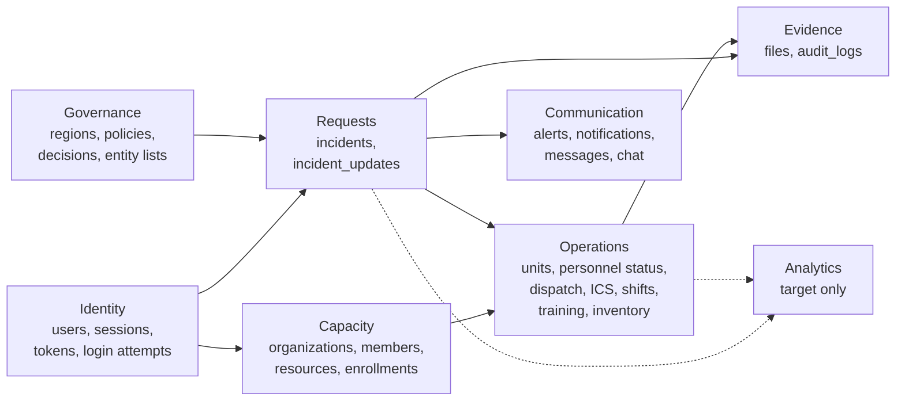
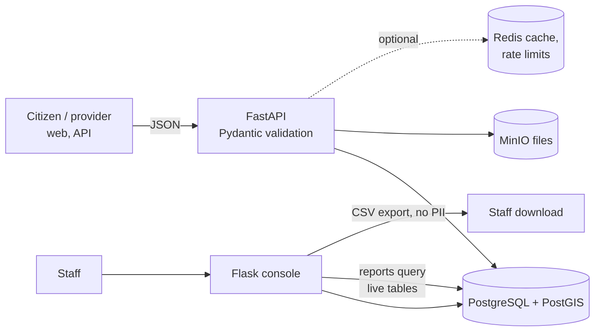
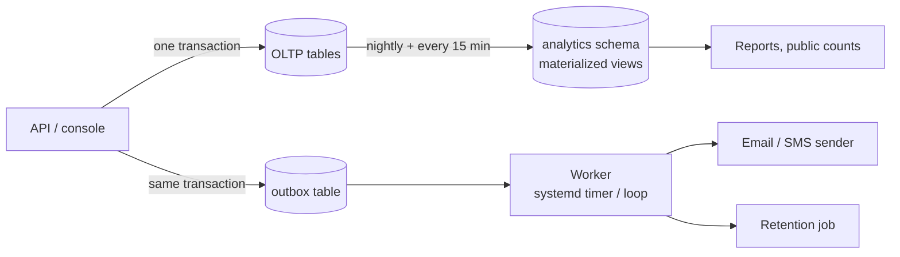
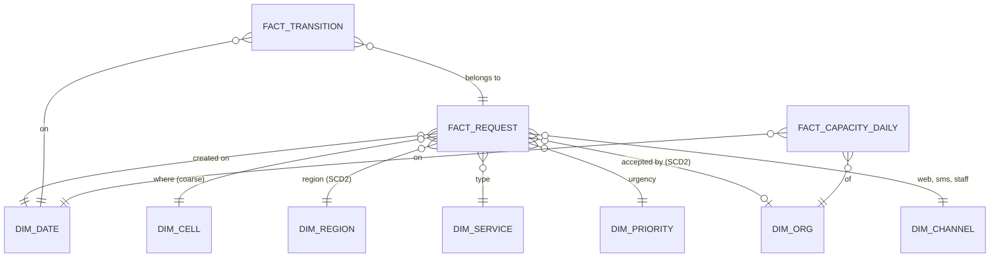

# IDRM — Data design (master)

> **What this is:** the one place to understand all of IDRM's data — what it
> is, why it is held, how it is protected, how it moves, how it is analysed,
> and how it is handled at every stage of building and running the product,
> for the **MVP** and the **FFP** (full-fledged product).
>
> **Written to the brief** in [instructions.md §2](../../instructions.md#2-the-data-design-brief).
> **Privacy in depth** lives in its own part,
> [PRIVACY-FIRST-DATA-DESIGN.md](PRIVACY-FIRST-DATA-DESIGN.md) (accepted as
> [ADR-0015](../adr/0015-privacy-first-reveal-ladder.md)); this document
> summarises it in §3 and does not repeat it. **End-user workflows** — every
> task of every user, with the data read, written and revealed at each step —
> live in [DATA-WORKFLOWS.md](DATA-WORKFLOWS.md) (area 13; summary in §1.1).
> **Defaults and settings** — what happens to data if nothing is configured,
> and every privacy, file, audit and retention setting — are in
> [DATA-CONFIGURATION.md](DATA-CONFIGURATION.md).
>
> **How it was checked (2026-11-24):** by reading the models, migrations,
> routers, dashboard services, Makefile, `.env.example`, `docker-compose.yml`,
> the ops and infra docs, and the MVP/FFP specs in `~/Downloads/idrm-artifacts/docs/`.
> **Nothing was run.** "Today" below means "read in the code", not "seen working".

### Status labels used throughout

| Label | Meaning |
|---|---|
| **Today** | Read in the current code on branch `fix/review-findings-and-approval-first` |
| **Accepted** | Decided by the owner in an ADR; may not be built yet |
| **Proposed** | This document's recommendation; needs an owner decision (§12) |
| **FFP** | Planned for the full-fledged product, not the MVP |

---

## Contents

0. [Reading paths](#0-reading-paths)
1. [Product context: why the data exists](#1-product-context-why-the-data-exists)
2. [Data inventory and model](#2-data-inventory-and-model)
3. [Privacy-first (summary)](#3-privacy-first-summary)
4. [Data security](#4-data-security)
5. [Data engineering: how data moves](#5-data-engineering-how-data-moves)
6. [Data warehousing and analytics](#6-data-warehousing-and-analytics)
7. [Data quality and governance](#7-data-quality-and-governance)
8. [Data across the SDLC](#8-data-across-the-sdlc)
9. [Operations: backups, retention, monitoring, capacity](#9-operations-backups-retention-monitoring-capacity)
10. [MVP → FFP roadmap](#10-mvp--ffp-roadmap)
11. [Today vs target: the data gap list](#11-today-vs-target-the-data-gap-list)
12. [Decisions for the owner](#12-decisions-for-the-owner)
13. [Check your understanding](#13-check-your-understanding)

---

## 0. Reading paths

| You are… | Read |
|---|---|
| New to everything | §1 → §2 → §3 → the summary line at the top of each later section |
| Building a feature | §2.4 conventions, §3, §8 (the checklist for your stage), §11 |
| Writing a migration | §2.4, §5.6, §8.3 |
| Building a report or dashboard | §3, §6 |
| Running the system | §4, §9 |
| Deciding things | §10, §11, §12 |

---

## 1. Product context: why the data exists

> **In one line:** every piece of data must trace back to a product need in the
> PRD. If nothing needs it, we do not collect it.

IDRM's PRD (`idrm-artifacts/docs/mvp/10-requirements-prd.md`) has three
objectives: **save lives** (faster response), **improve efficiency** (less
duplication, right responder), **build trust and transparency** (status
visible, data for planning). Its NFR-3 asks to "protect personal and location
data; enforce access control; audit actions".

The core journey, and the data each step creates:

| Step (who) | What happens | Data created | Why it is needed |
|---|---|---|---|
| 1. Ask (citizen / guest) | Submits a request | `incidents` row: type, priority, point, description; guest phone; tracking token | To know what, where, how urgent, and to reach them |
| 2. Triage (coordinator) | Approves or rejects (ADR-0014) | `incident_updates` row; `audit_logs` row; or an auto-approval decision row | Accountability; approval-first |
| 3. Claim (provider) | Accepts an approved request | status → `accepted`; assigned org | Who is responsible |
| 4. Dispatch (org) | Sends a unit / people | `dispatch_*`, `unit_statuses`, `personnel_statuses` (live location) | Coordination, safety of responders |
| 5. Do (provider) | Starts, completes, uploads proof | status changes; `files` | Progress, evidence |
| 6. Confirm (citizen) | Verifies, rates | status → `verified`; rating, review | Trust, quality of providers |
| 7. Learn (coordinator, government) | Reports, heat maps | reads only (today); warehouse facts (target) | Planning, transparency (O3) |

### 1.1 Workflows by user (summary)

| User | Workflows ([DATA-WORKFLOWS.md](DATA-WORKFLOWS.md)) | Most sensitive data they touch |
|---|---|---|
| Guest | W1 report without an account · W2 track and confirm | own location, phone |
| Citizen | W3 register/sign in · W4 report · W5 follow, cancel, rate · W6 manage my data · W7 receive alerts | own account and requests |
| Provider | W8 join an org / enrol · W9 go on duty, share location · W10 find and accept · W11 do the work, reveal phone, upload proof · W12 offers, shifts, chat | requester's exact location and phone (after assignment); own live location |
| Coordinator | W13 triage · W14 assign and dispatch · W15 auto-approval switch · W16 verify orgs/volunteers · W17 area alerts · W18 break-glass + review · W19 reports and export | full requests in own region |
| Admin | W20 users · W21 blocklists · W22 audit · W23 data requests, legal hold, job health | accounts; case detail only by break-glass |
| Public / analysts | W24 counts per cell/day (k ≥ 5) | none personal |
| Nobody (scheduled) | W25 retention · W26 analytics refresh · W27 backups | all of it — these jobs delete, blur and protect |

Walking the workflows found three more gaps — WF1 (email written into the
audit log at registration), WF2 (no alerts endpoint for citizens), and **WF3
(a self-registered provider is active at once and, today, sees every request's
exact location)** — listed in DATA-WORKFLOWS.md §9 and in §11 below.

Supporting data: accounts and sessions (identity), organizations and their
resources (capacity), shifts, training, inventory, ICS command structure
(operations), alerts and notifications (communication), policies and
blocklists (governance), audit (evidence).

---

## 2. Data inventory and model

> **In one line:** about 60 tables in one PostgreSQL + PostGIS database,
> grouped into eight domains; only a few hold personal data, and those few are
> where most of the care goes.

### 2.1 Three levels of a data model

| Level | Question it answers | Where it lives for IDRM |
|---|---|---|
| **Conceptual** | What *things* exist and how they relate, in business words | §2.2 below |
| **Logical** | Which attributes, keys and rules each thing has, independent of the database product | `idrm-artifacts/docs/mvp/50-data-model.md` (intent) |
| **Physical** | Exact tables, columns, types, indexes in PostgreSQL | `shared/models/*.py` + `alembic/versions/` (**the truth**, ADR-0001); summary in `docs/03-data-model.md` |

### 2.2 Conceptual model: the eight domains



### 2.3 Domain register

Sensitivity tiers (T0 public … T3 sensitive, S secret) are defined in the
privacy part §6.

| Domain | Main tables | Owning code | Highest tier | Growth | Retention (Accepted / Proposed) |
|---|---|---|---|---|---|
| Identity | `users`, `user_sessions`, `password_*`, `email_verification_tokens`, `login_attempts` | `app/modules/users`, `shared/sessions.py` | T2 + S | per user; attempts per login | sessions/attempts 90 d; deactivated accounts pseudonymised after 1 y |
| Requests | `incidents`, `incident_updates` (+ `incident_contacts`, `pii_reveals` — Accepted, not built) | `app/modules/incidents`, `shared/lifecycle.py` | T3 | spikes 100× in a disaster | contacts 30 d after close; exact point coarsened 30 d; text 90 d; counts forever |
| Capacity | `organizations`, `organization_members`, `resources`, `volunteer_enrollments`, `user_delegations` | `app/modules/organizations` | T2 (contact phone) | slow | while active |
| Operations | `units`, `unit_*`, `personnel_*`, `dispatch_*`, `incident_commands`, `incident_lanes`, `lane_assignments`, `run_logs`, `shifts`, `shift_*`, `trainings`, `training_*`, `personnel_certifications`, `calendar_events`, `event_rsvps`, `inventory_*` | `app/modules/{personnel,dispatch,ics,scheduling,logistics}` | T3 (live location) | steady; location events fast | live-location history 7 d; rest while relevant |
| Communication | `alerts`, `notifications`, `notification_preferences`, `notification_deliveries`, `messages`, `chat_channels`, `chat_messages` | `app/modules/comms`, `shared/notifications.py` | T2 | fast | notifications 30 d; messages 90 d |
| Governance | `regions`, `auto_approval_policies`, `auto_approval_decisions`, `entity_lists`, `entity_list_matches`, `rate_limit_events`, `mutual_aid_agreements`, `bigboard_*` | `shared/governance/`, `app/modules/policies` | T2 (raw identifiers in lists) | slow | decisions with the request; lists while active |
| Evidence | `files` (+ MinIO objects), `audit_logs` | `app/modules/files`, `shared/audit.py` | T3 (photos) | photos dominate storage | photos 30 d after close; audit ≥ 1 y (7 y target) |
| Analytics | none today | — | T0–T1 by design | — | aggregates forever |

### 2.4 Physical conventions (Today) and why

| Convention | What | Why | Watch out |
|---|---|---|---|
| **UUID primary keys** | `gen_random_uuid()` | Ids can be made anywhere (offline apps, other services) without clashing, and do not reveal how many requests exist | Larger than integers; random order fragments indexes slightly — fine at MVP scale |
| **`timestamptz`, UTC** | every time column | India has one time zone, but servers, partners and the FFP may not | Display in IST, store in UTC |
| **Soft delete** | `deleted_at` on main tables | Undo and investigation | Soft-deleted personal data is still personal data: retention must hard-delete it |
| **`updated_at` trigger** | `sql/04_triggers.sql`, revision 0004 | Correct even when code forgets | — |
| **PostGIS, SRID 4326** | `geometry(Point, 4326)`; distance with `::geography` | Standard GPS coordinates; `geography` measures in metres | Degrees are not metres — the router comments explain this |
| **GiST / GIN indexes** | spatial and text indexes in `sql/03_indexes.sql` | "Requests within 10 km" and text search stay fast | — |
| **PostgreSQL enums** | 30+ enum types (`sql/01_…`) | The database itself rejects an invalid status | Adding a value needs a migration; removing one is hard |
| **JSONB** | `preferences`, policy conditions, audit values, metadata | Flexible shapes | Unvalidated by the database; never hide personal data in it |
| **Append-only audit** | trigger blocks UPDATE/DELETE (ADR-0003) | Tamper-evidence | A database superuser can still disable a trigger (see `docs/08-security.md` on limits) |
| **State changes through one module** | `shared/lifecycle.py` | One place defines legal transitions | — |

---

## 3. Privacy-first (summary)

> **In one line:** hide by default, reveal by need, never let hiding block a
> rescue. **Accepted** (ADR-0015), **not built** (PENDING-TASKS Part G).

- **Tiers:** T0 public · T1 operational (about the need) · T2 personal ·
  T3 sensitive · S secret. Every column carries one.
- **Reveal ladder:** providers see nothing before approval; coarse location
  (~1 km urban, ~5 km rural) and a scrubbed summary before assignment; exact
  point, description and a one-tap recorded phone reveal after assignment;
  back to coarse 72 h after closure. Admins only via break-glass.
- **Mechanisms:** contact details in their own table; one shaping function
  for all output; snap-to-grid (not random noise); audit records the fact,
  never the value; HMAC-hashed identifiers in blocklists; retention job;
  EXIF stripping; public data only as counts with k ≥ 5.
- **Law:** India's DPDP Act 2023 — notice, legitimate use for life safety
  (to be confirmed by counsel), rights to access/correct/erase, breach
  notification.

Full detail, threats, walk-throughs and the FFP privacy features:
[PRIVACY-FIRST-DATA-DESIGN.md](PRIVACY-FIRST-DATA-DESIGN.md).

---

## 4. Data security

> **In one line:** keep data **confidential** (only the right people read it),
> **intact** (nobody changes it wrongly), and **available** (it is there in a
> disaster) — with several independent layers, so one failure is not a breach.

### 4.1 Privacy vs security — the difference

**Security** stops the *wrong* people from getting data. **Privacy** limits
what even the *right* people see and how long we keep it. A perfectly secure
system can still violate privacy (every provider seeing every phone number is
"secure" — they are all logged in — and still wrong).

### 4.2 Defence in depth

```
 ┌──────────────────────────────────────────────────────────────────┐
 │ 1 Network      firewall; DB, Redis, MinIO not on the internet    │
 │ 2 Transport    HTTPS/TLS to users; TLS between app and DB/MinIO  │
 │ 3 Identity     bcrypt passwords, RS256 JWT, server sessions      │
 │ 4 Authorisation role + ownership (authz.py) + reveal ladder      │
 │ 5 Database     least-privilege DB roles; constraints; triggers   │
 │ 6 Storage      disk encryption; FFP field encryption (KMS)       │
 │ 7 Evidence     append-only audit; reveal log; break-glass review │
 │ 8 Recovery     encrypted, tested backups; point-in-time restore  │
 └──────────────────────────────────────────────────────────────────┘
```

### 4.3 Controls: today and target

| Control | Today | Target | Status of target |
|---|---|---|---|
| Passwords | bcrypt hashes; password history | same | — |
| Tokens | RS256 JWT access + refresh, refresh hashed, family reuse detection, server-side sessions (ADR-0010, 0013) | same | — |
| Authorisation | role + ownership checks (`app/core/authz.py`), but incidents shown to every provider | reveal ladder | Accepted (ADR-0015) |
| **Database roles** | the app connects as one user from `DATABASE_URL` (whether it owns the schema depends on the install) | four roles: `idrm_migrator` (DDL, used only by Alembic), `idrm_app` (read/write data, no DDL), `idrm_reporting` (reads `analytics` views only), `idrm_backup` | Proposed (E2) |
| TLS app → DB | not configured in code (`DATABASE_URL` has no `sslmode`) | `sslmode=require` whenever DB is on another host | Proposed |
| Secrets | `.env`, never committed (rule 10); JWT keys as files | FFP: vault/KMS with rotation | FFP |
| Encryption at rest | whatever the disk provides | MVP: full-disk encryption on the server; FFP: field-level AES-256-GCM, envelope keys, crypto-shredding | Proposed / FFP |
| Object storage | private MinIO bucket, presigned links (1 h) | 5-min links, EXIF stripped, image `minio` pinned to a version (today `:latest`) | Accepted (links, EXIF) / Proposed (pin) |
| Integrity | FKs, CHECKs, enums, transactions, `get_db` rollback (rule 7) | + data-quality checks (§7) | Proposed |
| Audit | append-only `audit_logs`, every state change (rule 6) | + no personal values inside; reveal log | Accepted |
| Rate limiting / abuse | per-route limits; entity lists | + reveal rate limit; hashed list values | Accepted |
| Backups | `make dump` exists; **no schedule installed** (infra plan gap 3) | §9.1 | Proposed (E3) |

### 4.4 Data threat model (STRIDE, data view)

STRIDE is a checklist of six threat kinds. For each, the data-specific risk:

| Threat | IDRM data example | Main control |
|---|---|---|
| **S**poofing | Fake provider account | Org verification; approval-first; reveal ladder |
| **T**ampering | Status changed to "completed" without work | Lifecycle module + role checks + audit |
| **R**epudiation | "I never saw that phone number" | `pii_reveals` + audit |
| **I**nformation disclosure | Bulk scrape of locations; leaked backup | Ladder; rate limits; encrypted backups; retention |
| **D**enial of service | Flood of fake requests during a disaster | Rate limits; blocklists; approval-first |
| **E**levation of privilege | Coordinator acting as admin; SQL injection | Role checks; parameterised SQL; least-privilege DB role |

### 4.5 When something leaks: breach response

| Step | Within | Who | What |
|---|---|---|---|
| Detect | — | ops / anyone | Alerts on unusual reveal rates, export sizes, failed logins (§9.4) |
| Contain | hours | ops | Revoke sessions (`token_version`), rotate keys and secrets, block accounts |
| Report to CERT-In | **6 hours** of noticing a reportable cyber incident (Indian CERT-In directions, 2022) | owner / security lead | Basic facts first, details later |
| Assess | days | owner + DPO | Which tiers, how many people, which fields — `pii_reveals` and audit answer this |
| Notify | as the DPDP Rules require | owner | Data Protection Board and each affected person |
| Learn | weeks | team | Post-incident review; fix; update this document |

*Not legal advice; confirm deadlines with counsel.*

---

## 5. Data engineering: how data moves

> **In one line:** today all data moves inside one request–response; the
> target adds a reliable way to hand changes to other consumers (notifications,
> analytics) without losing or duplicating them.

### 5.1 Words

| Word | Meaning |
|---|---|
| **Pipeline** | A repeatable path data takes from a source to a destination, with steps in between |
| **ETL / ELT** | Extract, Transform, Load — or Load first, Transform inside the warehouse (ELT, the modern default) |
| **Batch vs stream** | Move data in scheduled chunks (every night) vs continuously (each change within seconds) |
| **Idempotent** | Doing it twice has the same effect as once. Essential when networks retry |
| **Outbox** | Write "something happened" to a table in the *same* transaction as the change; a worker delivers it later |
| **CDC** | Change Data Capture: read the database's own change log to see every insert/update/delete |
| **Data contract** | A written promise about a dataset's shape and meaning that producers may not break silently |

### 5.2 Today



- Validation: Pydantic at the edge (shape only, ADR-0008), then database
  constraints.
- Notifications: rows in `notifications` only; **email/SMS delivery does not
  exist** (`notification_deliveries` stays empty).
- Reports: `dashboard/services/reports.py` and `kpi.py` run aggregate queries
  on the live tables. The incident CSV export holds id, type, priority,
  status, date — **no personal data** (good), up to 100,000 rows in memory.
- No outbox, no queue, no scheduled jobs in code.

### 5.3 Target (MVP, Proposed)



**Why an outbox?** If the code saves the request and then sends an SMS, one of
the two can fail: a saved request with no SMS, or an SMS about a request that
rolled back. Writing an outbox row *in the same transaction* makes both
happen or neither; the worker retries delivery until it succeeds, and each
message carries an id so the receiver ignores duplicates (idempotent).

### 5.4 Intake in a disaster: duplicates and retries

Networks fail mid-request. The phone retries. Without care, Meera's one
request becomes three.

| Problem | Fix | Status |
|---|---|---|
| Same submission sent twice | Client sends an `Idempotency-Key` header (a random id per submission); the server stores it with the request and returns the first result for a repeat | Proposed (E5) |
| Different people report the same emergency | Flag *possible duplicates*: same service type, within ~100 m, within 30 min. A coordinator merges; never auto-delete | Proposed (E5) |
| Offline phones (FFP mobile, SMS) | Queue locally, send later with the original time; server keeps both `reported_at` and `received_at` | FFP |

### 5.5 Enrichment

When a request arrives, derive data once rather than at every read:
`region_id` by point-in-polygon (`ST_Contains` on `regions`); `location_coarse`
by snapping (privacy part §8.3); `public_summary` by scrubbing. Region already
exists today; the other two are Accepted.

### 5.6 Schema evolution without downtime: expand → migrate → contract

Never rename or drop in one step while the app runs.

1. **Expand:** add the new column/table (nullable). Old code still works.
2. **Migrate:** deploy code that writes both; back-fill old rows in batches.
3. **Contract:** once nothing reads the old column, drop it in a later revision.

Example: moving `guest_contact` to `incident_contacts` (ADR-0015) — add the
table, copy, switch reads, then drop `guest_contact` in a second revision.
Every step is a **new Alembic revision** (rule 2) with a working `downgrade`.

### 5.7 Orchestration and observability

| | MVP (Proposed) | FFP |
|---|---|---|
| Scheduling | systemd timers (the installer already uses systemd) for retention, outbox worker, view refresh, backups | A workflow tool (e.g. Airflow, Dagster) with retries, dependencies, history |
| Watching jobs | Each job writes a `job_runs` row (start, end, rows, error) and exits non-zero on failure | Same, plus data observability: freshness, volume, schema-change and null-rate alerts |

---

## 6. Data warehousing and analytics

> **In one line:** answer the PRD's questions ("how fast did help arrive, and
> where did it not?") from a separate, privacy-safe, analysis-shaped copy of
> the data — never by scanning the live tables during a disaster.

### 6.1 Why a separate analytical store

| | OLTP (today's tables) | OLAP (analytics) |
|---|---|---|
| Purpose | Run the service: one request at a time | Understand the service: millions of rows at once |
| Shape | Normalised (no repetition), many joins | Denormalised **star schema**, few joins |
| Load | Many small reads/writes | Few huge reads |
| Personal data | Needed | **Not needed** — and therefore not copied |

Running big reports on the live tables during a flood competes with the
requests that save lives. A separate store also means a reporting bug can
only leak what was copied there — which is nothing personal.

### 6.2 The questions (metrics), defined precisely

A metric is only useful if everyone computes it the same way.

| Metric | Definition | Source |
|---|---|---|
| Time to approve | first `approved` time − `created` time | `incident_updates` |
| Time to accept | first `accepted` − first `approved` | same |
| Time to help | first `in_progress` − `created` | same |
| Time to complete | first `completed` − `created` | same |
| Unanswered rate | requests ending `cancelled`/`rejected` with no `accepted`, ÷ all requests, per period and region | same |
| Coverage gap | open approved requests with no accepting org within *X* hours, by grid cell | facts + cells |
| Verification rate | `verified` ÷ `completed` | same |
| Provider load | accepted requests per org per day | facts |
| Rural vs urban | any metric split by the region's rural marker (ADR-0015 D3) | dim_region |

Report medians and 90th percentiles, not only averages: one 3-day outlier
hides a typical 40 minutes. These directly measure PRD objective O1 (the PRD
cites "~12-hour average response" and "~40% unanswered" as the problem).

### 6.3 Dimensional model (star schema)

A **fact** is something that happened and can be counted or timed. A
**dimension** describes the fact (when, where, what). **Grain** = what one
fact row stands for.



| Table | Grain | Key columns |
|---|---|---|
| `fact_request` | one row per request (an *accumulating snapshot*: milestone times filled in as it progresses) | surrogate key, created/approved/accepted/in-progress/completed/verified times, durations, final status, auto-approved flag, vulnerable-person flag (yes/no only) |
| `fact_transition` | one row per state change | from, to, time, actor **role** (not actor id) |
| `fact_capacity_daily` | one row per org per day (*periodic snapshot*) | units available, personnel on duty, inventory levels |
| `dim_cell` | one grid cell (0.01° / 0.05°) | cell centre, region, rural flag |
| `dim_region`, `dim_org` | **SCD type 2**: a new row each time a region boundary or an org's details change, with valid-from/valid-to | so last year's report uses last year's boundaries |
| `dim_date` | one calendar day | IST date, weekday, monsoon season flag, disaster-event flag (FFP C-1) |

**Deliberately absent:** a citizen dimension, names, phones, exact points,
free text, photos. The warehouse cannot leak what it never received.
Individual responders appear, if ever, only as a pseudonymous key for
workload balance, never in published output.

### 6.4 Publishing safely

| Audience | What | Rule |
|---|---|---|
| Staff (console reports) | Any aggregate | Read via `idrm_reporting` role |
| Government partners | Aggregates per cell/day | k ≥ 5; cells under 5 merged into "other" |
| Public / open data | Aggregates per region/week | k ≥ 5; FFP: differential privacy (calibrated noise) |
| Researchers | Request-grain facts, coarse cell, no free text | Data-sharing agreement; FFP |

### 6.5 MVP and FFP implementations

| | MVP (Proposed, E1) | FFP |
|---|---|---|
| Where | An `analytics` **schema in the same PostgreSQL**, built from **materialized views** (stored query results) refreshed every 15 min and nightly | A separate warehouse fed by CDC/events from each service |
| Transform | SQL in a migration-managed file | dbt (SQL transformations with tests and lineage) |
| Engine | PostgreSQL | Options: PostgreSQL read replica + dbt (cheapest); a columnar engine such as ClickHouse (fast aggregates at national scale); a cloud warehouse (only if hosted in India) |
| Files / photos | Not in analytics | An object-store "lake" only for derived, de-identified data (e.g. damage classification counts) |
| Trigger to move | Report queries slow the live system, or data spans several services | — |

**Why not a separate warehouse now?** One more system to secure, back up and
pay for, before there is enough data to need it. Materialized views give the
same star shape, the same privacy boundary, and a clean path out.

---

## 7. Data quality and governance

> **In one line:** decide who owns each piece of data, write down what
> "correct" means, and check it automatically.

### 7.1 Quality dimensions, with IDRM examples

| Dimension | Meaning | IDRM check | Where |
|---|---|---|---|
| **Validity** | Values in allowed form | Lat/long within India's bounding box; phone matches Indian format; rating 1–5 | Pydantic + CHECK (rating exists today) |
| **Completeness** | Required values present | Request has type, priority, point | NOT NULL (Today) |
| **Uniqueness** | No unintended duplicates | Idempotency key; duplicate-report flag | Proposed (§5.4) |
| **Consistency** | Data agrees with itself | Status matches the last `incident_updates.to_status`; `verified_at` set iff status `verified` | Nightly check query |
| **Accuracy** | Matches reality | Citizen verification; provider rating | Product flow (Today) |
| **Timeliness** | Fresh enough | Analytics views < 15 min old; responder status < 10 min old or shown stale | Job monitoring |
| **Region coverage** | Point falls in a known region | `region_id` NULL → "outside known region" (decision reason exists) | Today |

Failed checks write to a `data_quality_issues` table and appear on the
console's health page (Proposed).

### 7.2 Roles and ownership

| Role | Who (MVP) | Responsible for |
|---|---|---|
| **Data owner** (accountable) | Product owner | Purpose, who may access, retention; signs off DPIA |
| **Data steward** per domain | Lead developer of that module | Definitions, quality rules, this document's domain rows |
| **Data custodian** | Ops / installer owner | Backups, access, patching, encryption |
| **Data Protection Officer / grievance officer** | Named person (DPDP needs a contact for grievances) | Rights requests, breach coordination |
| **Data principal** | Citizens, responders | Their rights (access, correct, erase, grievance) |

### 7.3 Metadata: catalogue and lineage

- **Catalogue** (what data exists and what it means): MVP = §2.3 of this
  document + `docs/03-data-model.md` + column comments in migrations
  (Proposed: add `comment=` with the tier, e.g. `"T2: requester phone"`);
  FFP = a catalogue tool (e.g. OpenMetadata, DataHub).
- **Lineage** (where a number came from): MVP = each analytics view's SQL
  names its sources; FFP = dbt lineage graph.
- **Classification register:** the tier comment on every column, checked in
  CI: a new column without a tier comment fails the lint (Proposed).

---

## 8. Data across the SDLC

> **In one line:** data work is not a phase; every stage of building and
> running IDRM has data tasks and a data check before moving on.

### 8.1 Stage by stage

| Stage | Data activities | Gate (must be true to move on) | Artefact |
|---|---|---|---|
| **1. Requirements** | List data each feature needs and why; classify tiers; who sees it (ladder); retention; legal basis | Every new field has a purpose and tier | PRD/FS row; DPIA note for T2/T3 |
| **2. Design** | Conceptual → logical model; access rules; flows; metrics definitions; migration plan (expand/contract) | Design reviewed for privacy and security; ADR if a product choice | This document; ADR |
| **3. Build** | Alembic revision; models; shaping via `shared/privacy.py`; audit rows; tier comments | Lint passes (boundaries, tiers); no secrets | Code + migration |
| **4. Test** | Unit tests; `pg` tests on `*_test` DB (rule 9); ladder tests per role × state; migration up/down test; synthetic data only | No test accepts a 500; privacy tests green | Test report |
| **5. Release** | Backup before migrate; run expand step; back-fill; verify counts | Restore of last night's backup proven this month | Release checklist |
| **6. Operate** | Retention, quality checks, view refresh, monitoring, rights requests, break-glass review | Jobs green; no unreviewed break-glass older than 72 h | `job_runs`, dashboards |
| **7. Change / retire** | Contract step; archive or delete data of retired features; decommission old copies | Old data deleted or migrated; nothing orphaned in backups beyond 35 d | Decommission note |

### 8.2 Test data: never real people

- Development and test use only **synthetic data** (`scripts/seed.py`,
  `SEED_PASSWORD`). Production data is **never** copied to a laptop or a
  test database.
- If a production problem must be reproduced, reproduce it with synthetic
  rows of the same shape; if that is impossible, use a masked copy made on
  the server (names, phones, text replaced; points snapped) and delete it after.
- Tests that write rows run only on a database named `*_test` (rule 9).

### 8.3 Pull-request checklist for any data change

- [ ] New column has a purpose, a tier comment, and a retention rule
- [ ] Schema change is a new Alembic revision with a working downgrade
- [ ] Rename/drop uses expand → migrate → contract
- [ ] Output passes through the shaping function; no new endpoint returns raw rows
- [ ] State changes go through `shared/lifecycle.py` and write an audit row with no personal values
- [ ] Tests cover each role and state that sees the new data
- [ ] Analytics: no T2/T3 column copied into `analytics`
- [ ] Docs: the domain row in §2.3 and the owning doc are updated

---

## 9. Operations: backups, retention, monitoring, capacity

### 9.1 Backups and disaster recovery

**RPO** (recovery point objective) = how much data you can afford to lose.
**RTO** (recovery time objective) = how long you can be down.

| | Today | Target MVP (Proposed, E3/E4) | FFP |
|---|---|---|---|
| Method | `make dump` (`pg_dump`) exists, run by hand; no schedule installed | Nightly `pg_dump` **plus** continuous WAL archiving (e.g. pgBackRest) for point-in-time restore | Managed replicas across two sites |
| RPO | up to "whenever someone last ran it" | ≤ 5 minutes | ≈ 0 (synchronous replica) |
| RTO | unknown | ≤ 4 hours | ≤ 15 minutes |
| Storage | `backups/` on the same machine | Encrypted, off-machine copy, 35-day retention | Two regions in India |
| MinIO files | not backed up | Nightly mirror of the bucket, same retention | Replicated object store |
| Proof | none | **Monthly restore drill** into a scratch database, row counts compared | Automated |

A backup that has never been restored is a hope, not a backup. And a disaster
platform must survive the disaster: the server should not sit in the flood zone
it serves.

### 9.2 Retention job

Daily; applies the table in the privacy part §8.11 and the domain register
§2.3; respects `legal_hold`; writes a `job_runs` row and an audit row with
counts only. Accepted (ADR-0015), not built (Part G, G-7).

### 9.3 Capacity — a rough estimate

| Item | Assumption (a large disaster day) | Size |
|---|---|---|
| Requests | 50,000 / day × ~2 KB (row + updates + indexes) | ~100 MB / day — trivial for PostgreSQL |
| Responder location events | 5,000 people × 1 / min × 200 B | ~1.4 GB / day → why history is kept only 7 days |
| Photos | 50,000 × 2 photos × 2 MB | **~200 GB / day** — the real capacity risk |

So: **resize and recompress photos on upload** (e.g. longest side 1600 px,
JPEG quality ~80 → ~300 KB), which also strips EXIF; this cuts photo storage
by ~85%. Proposed, folds into Part G G-3.

### 9.4 Monitoring (what to watch)

| Signal | Why |
|---|---|
| DB size, table bloat, slow queries (`pg_stat_statements`) | Performance before the surge, not during |
| Connections in use vs pool size | The first thing to run out under load |
| Job success and lateness (`job_runs`) | Silent retention/backup failure is a privacy and recovery failure |
| Reveals per user per hour; export sizes; break-glass count | Early warning of data harvesting |
| Analytics freshness | Reports must say how old they are |

---

## 10. MVP → FFP roadmap

| Area | MVP (now) | Next (when the trigger fires) | FFP |
|---|---|---|---|
| Storage | One PostgreSQL + PostGIS, MinIO | Read replica — *trigger:* reports or reads slow writes | Database per service (`idrm-monorepo/services/*`) |
| Privacy | Reveal ladder, retention, hashing (ADR-0015) | Privacy levels per request | Number masking, field encryption + KMS, crypto-shredding, self-service rights portal |
| Security | DB roles, TLS, backups with PITR | — | Vault/KMS, zero-trust service mesh |
| Movement | In-request; outbox + worker; systemd timers | Email/SMS delivery via outbox | Event bus, CDC, workflow orchestrator |
| Analytics | `analytics` schema of materialized views | dbt for transformations and tests | Separate warehouse; open data with differential privacy |
| Quality & governance | Checks table, tier comments, this document | Lint for tier comments | Catalogue + lineage tool; DPIA per release |
| Intake | Web/API, idempotency key, duplicate flag | SMS | Mobile offline-first, IVR, WhatsApp |
| Scale | One region | Several states | National; data residency in India |

---

## 11. Today vs target: the data gap list

Privacy gaps G1–G11 are in [IDRM-WORKSPACE-MAP.md §3.1](../review/IDRM-WORKSPACE-MAP.md#31-privacy-gaps--spec-says-one-thing-idrm-mvp-code-does-another)
and are being fixed under ADR-0015 (Part G). The other data gaps, all found
by reading, none confirmed by running:

| # | Gap | Risk | Fix | Status |
|---|---|---|---|---|
| X1 | No scheduled backups; MinIO not backed up; no restore drill | Total data loss | §9.1 | Proposed (E3) |
| X2 | App uses one database user | A bug or injection can alter schema or audit triggers | Four DB roles (§4.3) | Proposed (E2) |
| X3 | No TLS between app and database | Data readable on the network if DB is remote | `sslmode=require` | Proposed |
| X4 | Reports query live tables; CSV export builds up to 100,000 rows in memory | Slows the service in a surge | `analytics` schema; stream the CSV | Proposed (E1) |
| X5 | No idempotency key; no duplicate-report detection | Duplicate requests waste responders — the PRD's "duplication" problem | §5.4 | Proposed (E5) |
| X6 | No outbox; email/SMS not delivered | Citizens not told; lost or double messages once added | §5.3 | Proposed |
| X7 | No scheduled jobs of any kind | Retention, refresh, backups never happen | systemd timers + `job_runs` | Proposed |
| X8 | `minio:latest` unpinned in `docker-compose.yml` | A silent upgrade changes storage behaviour | Pin a version | Proposed |
| X9 | No column-level classification; `sql/02_tables.sql` is a placeholder | Nobody can list where personal data is | Tier comments; generate the dump (H-3) | Proposed |
| X10 | Photos stored at full size | ~200 GB/day in a large event | Resize on upload (§9.3) | Proposed |
| X11 | No data-quality checks beyond constraints | Inconsistent statuses go unnoticed | §7.1 | Proposed |

Workflow gaps WF1–WF3 are in [DATA-WORKFLOWS.md §9](DATA-WORKFLOWS.md#9-what-the-workflows-revealed-new-gaps).

**Fix order:** X1 (backups) first — nothing else matters if data is lost;
then Part G G-1 to G-3 **together with WF3** (only members of a verified
organization see request cards); then X2, X3, X7, WF1; then X5, X10, WF2;
then X4, X6, X11, X8, X9.

---

## 12. Decisions for the owner

Each, once answered, becomes an ADR quoting the owner. Recommended option
first. Numbered **E** to avoid confusion with ADR-0015's D1–D7.

| # | Question | Options (recommended first) |
|---|---|---|
| **E1** | Where should reports and analytics run in the MVP? | **(a) An `analytics` schema of materialized views in the same database** — same privacy boundary, no new system · (b) Keep querying live tables — simplest, slows the service in a surge · (c) A separate warehouse now — most scalable, most cost and effort before it is needed |
| **E2** | Split database access into separate roles? | **(a) Yes: migrator, app, reporting, backup** — a bug in one cannot change the schema or read beyond its job · (b) One user — simpler, one mistake reaches everything |
| **E3** | Backup method | **(a) Nightly dump + continuous WAL archive (point-in-time restore), encrypted, off-machine, monthly restore drill** · (b) Nightly dump only — simpler, may lose up to a day |
| **E4** | Recovery targets for the MVP | **(a) RPO ≤ 5 min, RTO ≤ 4 h** · (b) RPO ≤ 24 h, RTO ≤ 24 h — acceptable for a pilot, not for a live disaster |
| **E5** | Duplicate protection | **(a) Idempotency key + "possible duplicate" flag (100 m, 30 min), coordinator merges** · (b) Idempotency key only · (c) Automatic merging — risky: two neighbours with the same need are two requests |
| **E6** | Hosting location of data | **(a) India only, including backups and any cloud service** — trust and likely regulatory expectation for government-endorsed use · (b) Any region |
| **E7** | When to choose the FFP warehouse engine | **(a) Later, when §6.5's trigger fires; start FFP with PostgreSQL replica + dbt** · (b) Choose now |

---

## 13. Check your understanding

1. Name the difference between security and privacy with an IDRM example. *(§4.1)*
2. Why does IDRM need an outbox before it sends SMS? *(§5.3)*
3. What is the grain of `fact_request`, and why is there no citizen dimension? *(§6.3)*
4. Why report the median time to help, not only the average? *(§6.2)*
5. What must be true before a release that includes a migration? *(§8.1 stage 5)*
6. What is the single largest storage risk, and the cheap fix? *(§9.3)*
7. Which gap should be fixed first, and why? *(§11)*
