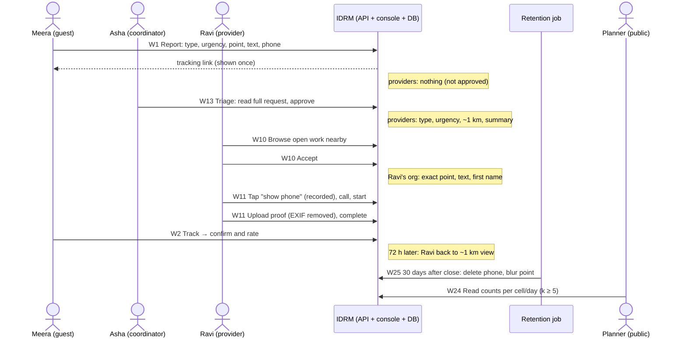

# IDRM — End-user workflows: the data, step by step

> **Part of:** [DATA-DESIGN.md](DATA-DESIGN.md) (master), area 13 of the brief in
> [instructions.md §2](../../instructions.md#2-the-data-design-brief).
> Privacy rules referred to here are owned by
> [PRIVACY-FIRST-DATA-DESIGN.md](PRIVACY-FIRST-DATA-DESIGN.md) (ADR-0015).
>
> **What this is:** every task each kind of user performs, followed one step at
> a time — what they do, where (screen or API endpoint), which data is read and
> written, how sensitive it is, who can see it afterwards, what is recorded in
> the audit log, and what can go wrong. Each workflow shows **Today** (read in
> the code on 2026-11-24, not run) and the **Target** (Accepted in ADR-0015, or
> Proposed in the master document).
>
> **Update 2026-11-24:** the provider-visibility rules (G-1, G-2, WF3) now have
> code written in `shared/privacy.py` and the incident router — **not yet run
> against a database**. Where a card says "Today: every provider sees …", that
> is the behaviour before this change; the target for W1, W2, W8 and W10 is
> what the new code does (except the ~5 km rural grid and the 72-h window,
> which come later).

---

## Contents

0. [How to read a workflow card](#0-how-to-read-a-workflow-card)
1. [The whole picture: one request, five people](#1-the-whole-picture-one-request-five-people)
2. [Guest (no account)](#2-guest-no-account) — W1, W2
3. [Citizen](#3-citizen) — W3–W7
4. [Provider](#4-provider) — W8–W12
5. [Coordinator](#5-coordinator) — W13–W19
6. [Admin](#6-admin) — W20–W23
7. [Public, partners and analysts](#7-public-partners-and-analysts) — W24
8. [Background workflows nobody clicks](#8-background-workflows-nobody-clicks) — W25–W27
9. [What the workflows revealed: new gaps](#9-what-the-workflows-revealed-new-gaps)
10. [Check your understanding](#10-check-your-understanding)

---

## 0. How to read a workflow card

Each workflow is a short card:

| Column | Meaning |
|---|---|
| **Step** | One thing the person does |
| **Where** | API endpoint as declared in `app/modules/*/router.py` (the app may add a path prefix), or console page (staff use the Flask console) |
| **Data read / written** | Which tables change; the **tier** in brackets — T0 public, T1 operational, T2 personal, T3 sensitive, S secret (privacy part §6) |
| **Who sees it next** | Today → Target |
| **Audit** | The `audit_logs` action written (rule 6: every state change is audited). Names were checked against the code: API incident actions are `incident.<verb>` (e.g. `incident.accept`); console actions start with `dashboard.`. Names marked *target* are proposed; "not checked" means not looked up |

Below each card: **What can go wrong** — the realistic failure, and the
protection.

The four roles are fixed: `citizen`, `provider`, `coordinator`, `admin`. A
**guest** is a citizen without an account. "Public" means anyone, signed in or
not.

---

## 1. The whole picture: one request, five people

Meera (guest) asks for help; Asha (coordinator) approves; Ravi (provider)
rescues; the retention job tidies up; a planner later reads the counts.
The right-hand notes show **how much of Meera's data each person can see** at
that moment in the target design.

---

## 2. Guest (no account)

Guests matter most in a disaster: no time, a borrowed phone, no wish to sign up.

### W1 — Report an emergency without an account

| Step | Where | Data read / written | Who sees it next (Today → Target) | Audit |
|---|---|---|---|---|
| Open the form, allow location or drop a pin | web form | nothing stored yet | — | — |
| Choose type and urgency, describe the need | form | — | — | — |
| Give a phone number (optional) | form | — | — | — |
| See the 3-line notice: who will see what, how long kept | form | **Target:** `consent_records` (notice version, legal basis = legitimate use) | — | target: `consent.recorded` |
| Submit | `POST /incidents` (rate-limited) | `incidents`: type, priority (T1), point (T2), description (T2); `guest_contact` (T2) → **target** `incident_contacts`; region found by point-in-polygon; auto-approval check → `auto_approval_decisions` | Today: **every provider**, exact point. Target: coordinators of that region only, until approved | `incident.created` |
| Receive tracking link | response | `tracking_token` (S). Target: stored as a hash only | Today: returned again to every viewer. Target: shown **once**, here | — |

**What can go wrong**
- *The network drops and the phone re-sends* → two requests. Protection:
  idempotency key (master §5.4, Proposed E5).
- *The description contains a phone number or an address* → scrubbed summary
  for anyone below assignment (privacy §8.4).
- *A prank or malicious report* → nothing reaches providers until a
  coordinator approves (ADR-0014); rate limits and blocklists slow floods.

### W2 — Track my request, confirm help arrived

| Step | Where | Data | Who sees | Audit |
|---|---|---|---|---|
| Open the tracking link | `GET /incidents/track/{token}` | reads the request and its timeline | only whoever holds the link | — |
| See status: waiting → approved → help on the way → done | same | T1 + own data | — | — |
| Confirm and rate *(registered citizens today; guests target)* | `POST /incidents/{id}/verify` | status → `verified`; rating, review (T2) | Today: providers, staff. Target: assigned org + staff | `incident.verify` |

**What can go wrong**
- *The link is shared or screenshotted* → anyone with it sees the request.
  Protection: the link shows only the requester's own data; it stops working
  once the request is purged (target).
- *Today*, providers and staff receive the token in every response, so anyone
  among them could follow the guest (gap G2).

---

## 3. Citizen

### W3 — Register and sign in

| Step | Where | Data | Who sees | Audit |
|---|---|---|---|---|
| Register: email, password, name, optional phone, language | `POST /auth/register` | `users` (T2), `password_hash` (S); role citizen; **status active at once** (email verification is FFP) | admins | `user.registered` — **Today it stores the email in `new_values`** (gap WF1) |
| Sign in | `POST /auth/login` | `login_attempts` (email, IP, device — T2), `user_sessions` (IP, user agent, device, refresh-token hash) | admins (sessions); the user (own sessions) | `auth.login`; every attempt also in `login_attempts` |
| Stay signed in | `POST /auth/refresh` | rotates refresh token; reuse of an old token revokes the whole family | — | `auth.refresh_reuse_detected` |
| See and end my sessions | `GET/DELETE /users/me/sessions…` | own sessions | the user | not checked |
| Sign out | `POST /auth/logout` | not checked | — | none found today; target `auth.logout` |

**What can go wrong**
- *Password guessing* → lockout after failed attempts; attempts recorded and
  committed before the error (rule 7).
- *Attempts logged for emails that are not users* → a list of strangers'
  emails. Target: HMAC-hash `login_attempts.email` (privacy §8.10).

### W4 — Report as a registered citizen

Same as W1, except: the request is linked by `requester_id`; no tracking token
is needed (the citizen uses `GET /incidents/mine`); contact comes from the
account. Target: the citizen chooses "show my number to the assigned team" or
"contact me only in the app" (privacy §7.2), stored in `incident_contacts`.

**Today:** providers see `requester_id`, so one person's requests can be linked
together (gap G4). **Target:** providers see only a per-request code.

### W5 — Follow, cancel, confirm, rate

| Step | Where | Data | Who sees | Audit |
|---|---|---|---|---|
| List my requests | `GET /incidents/mine` | own requests only | — | — |
| See the timeline | `GET /incidents/{id}/updates` | `incident_updates` (status, time, note — note is T2) | owner, staff, target: assigned org | — |
| Cancel ("help no longer needed") | `POST /incidents/{id}/cancel` | status → `cancelled`, `cancellation_reason` (T2) | same | `incident.cancel` |
| Confirm and rate | `POST /incidents/{id}/verify` | status → `verified`, rating, review | same | `incident.verify` |
| Get notified of each change | `GET /notifications`, mark read | `notifications` rows (T2: message text) | the user | — |

**What can go wrong**
- *Citizen never confirms* → request stays `completed`; the FFP adds automatic
  close (scope doc §3). Reports count `verified ÷ completed` (master §6.2).
- *Email/SMS updates* are not sent today (only in-app rows); target via the
  outbox (master §5.3).

### W6 — Manage my own data

| Step | Where | Data | Audit |
|---|---|---|---|
| See and edit my profile (name, phone, language, preferences) | `GET/PATCH /users/me` | `users` (T2) | target: `user.updated` with **field names only** |
| Change password | `POST /users/me/change-password` | `password_hash`, `password_history` (S); `token_version` bumped → other sessions end | `user.password_changed` |
| **Target:** ask "what do you hold about me?", correct, erase, withdraw consent, raise a grievance | console screen run by staff (MVP); self-service portal (FFP) | export of account, requests, and `pii_reveals` about me; erasure = delete contacts, pseudonymise account, keep audit facts | `dsr.received`, `dsr.completed` |

**What can go wrong**
- *Erasure versus the immutable audit log* → solved by keeping personal values
  out of audit (privacy §8.9); audit rows then need no erasure.

### W7 — Receive area alerts

| Step | Where | Data | Who sees |
|---|---|---|---|
| Coordinator issues an alert for an area (W17) | console | `alerts` (T0: title, message, severity, polygon) | everyone in the area |
| Citizen receives it | **Today: no alerts endpoint was found in `app/` routers** — alerts exist only in the console (gap WF2). **Target:** `GET /alerts?lat&lng` returns active alerts covering a point; FFP push/SMS | read only | — |

**Privacy note:** the alert query should send the citizen's location only to
compute "which alerts cover me" and **never store it** — the server needs no
record of who checked alerts from where.

---

## 4. Provider

A provider is a person working for an organization (NGO, hospital, volunteer
group). Responders are data subjects too: their location and hours are
personal data.

### W8 — Join: register, join an organization or enrol as a volunteer

| Step | Where | Data | Who sees | Audit |
|---|---|---|---|---|
| Register as provider | `POST /auth/register` (role provider is self-service) | `users` — **active at once** | admins | `user.registered` |
| Organization registers | `POST /organizations` | `organizations` (contact phone T2) | staff | `organization.created` |
| Coordinator verifies the org | `POST /organizations/{id}/verify` or console | `organizations.verified…` | — | `organization.verified` (console: `dashboard.organization.verified`) |
| Volunteer enrols for an org / event / region / service (ADR-0012) | `POST /volunteers/enroll` | `volunteer_enrollments` (notes T2) | coordinators | `volunteer.enrolled` |
| Coordinator approves / rejects | `POST /volunteers/{id}/approve|reject` | status, `rejection_reason` (T2) | the volunteer | `volunteer.approved/rejected` |

**What can go wrong — the most serious finding in this document**
- **Today, anyone can register as a provider, is active immediately, and every
  provider can list every request with its exact location** (`_may_view`
  returns true for any provider; gap G1). Together that is the "fake
  responder" threat made real: an unvetted sign-up sees where vulnerable
  people are. **Target:** request data is visible only to providers who belong
  to a **verified** organization, only for approved requests, coarse until
  assigned (ADR-0015 + gap WF3).

### W9 — Go on duty, share status and location

| Step | Where | Data | Who sees (Today → Target) | Audit |
|---|---|---|---|---|
| Set my status (available, responding, on scene…) with optional location | `PUT /personnel/me/status` | `personnel_statuses` (lat/long T3), `personnel_status_events` | Today: whoever can call `GET /personnel/statuses`. Target: dispatchers/coordinators of **my** org, only while on duty | `personnel.status_changed` |
| Unit status (dispatched, en route…) | `PUT /units/{id}/status` | `unit_statuses` (location T3) | same | `unit.status_changed` |
| Go off duty | same endpoint, `off_duty` | target: location recording stops; history kept 7 days | — | — |

**What can go wrong**
- *Tracking people after their shift* → target: no location stored while
  `off_duty`; history deleted after 7 days (gap G11).

### W10 — Find and accept work

| Step | Where | Data | Who sees | Audit |
|---|---|---|---|---|
| Browse nearby open requests | `GET /incidents/nearby?lat&lng&radius_km` | reads requests | Today: `created`, `approved`, `accepted`, `in_progress` requests, **exact points**, description, `requester_id`, tracking token. Target: **approved only**, ~1 km / ~5 km rural, scrubbed summary, "vulnerable person: yes/no", per-request code | — |
| Accept | `POST /incidents/{id}/accept` | status `approved` → `accepted` (only from approved, ADR-0014); `assigned_organization_id`; `incident_updates` | requester notified | `incident.accept` |
| Detail unlocks | `GET /incidents/{id}` | Target: exact point, description, photos, first name for the assigned org | assigned org | — |

### W11 — Do the work

| Step | Where | Data | Who sees | Audit |
|---|---|---|---|---|
| Reveal the phone to call | **Target:** `POST /incidents/{id}/reveal {field: phone, purpose}` | `pii_reveals` (who, field, purpose, expiry 24 h); rate-limited | the provider | `pii.revealed` — field name, never the number |
| Start | `POST /incidents/{id}/start` | status → `in_progress` | requester, staff | `incident.start` |
| Upload proof photo | `POST /files` (purpose `completion_proof`) | `files` row + MinIO object (T3: faces, house numbers). Target: re-encoded, EXIF removed, resized | Today: uploader + staff (1-hour links). Target: the §7 ladder, 5-minute links | `file.uploaded` (purpose, size) |
| Complete | `POST /incidents/{id}/complete` | status → `completed`; `closed_at` (target) starts the clocks | requester | `incident.complete` |
| 72 h later | automatic (target) | — | provider back to the coarse view | — |

**What can go wrong**
- *A photo of the rescued person's face and house* → stored privately, never
  published; deleted 30 days after closure (target); FFP blurs faces for any
  shared use.
- *Provider's phone stolen while signed in* → reveals are rate-limited and
  recorded; coordinator can force logout (W20).

### W12 — Dispatch offers, shifts and training

| Step | Where | Data (tier) |
|---|---|---|
| Respond to a dispatch offer (accept / decline) | `POST /dispatch/offers/{id}/respond` | `dispatch_offers` (note T2) |
| See and sign up for shifts | `GET /shifts`, `POST /shifts/{id}/signup` | `shift_signups` (attendance T2) |
| Training assigned / completed | `POST /trainings/{id}/assign` (staff) | `training_*`, `personnel_certifications` (T2) |
| Chat with team / dispatch | `/chat/channels…`, `/messages` | `chat_messages`, `messages` (T2; target 90-day retention) |

Each is visible to the person and their organization's coordinators; none is
needed outside the organization.

---

## 5. Coordinator

Coordinators work mainly in the **staff console** (Flask), whose pages check a
permission such as `view.incidents` or `act.incidents`.

### W13 — Triage: approve or reject

| Step | Where | Data | Who sees next | Audit |
|---|---|---|---|---|
| Open the queue of new requests | console `/incidents/` (`view.incidents`) | reads requests. Target: **own region** fully; other regions coarse | — | — |
| Read one request in full | console `/incidents/<id>` | exact point, description, photos (T2/T3). Target: phone behind a recorded reveal | — | — |
| Edit the public summary if the scrubber missed something | target | `public_summary` | providers | `incident.summary_edited` |
| Approve | console POST `/approve` or `POST /incidents/{id}/approve` | status → `approved`; `approved_by`; timeline | Target: providers now see the coarse card | `incident.approve` (console: `dashboard.incident.approved`) |
| Or reject with reason | `/reject` | `rejection_reason` (T2) | requester | `incident.reject` (console: `dashboard.incident.rejected`) |

**What can go wrong**
- *Too slow in a surge* → W15 auto-approval; every auto decision is recorded
  in `auto_approval_decisions` with its reason.
- *Possible duplicates* → target: flagged (same type, ~100 m, 30 min) for the
  coordinator to merge (master §5.4).

### W14 — Assign and dispatch

| Step | Where | Data | Audit |
|---|---|---|---|
| See the dispatch board | console `/dispatch/` or `GET /dispatch/board` | units, personnel status (T3 location) | — |
| Assign a unit / send an offer | console `/dispatch/assign`, `/offer` | `dispatch_assignments`, `dispatch_offers`; request may move to `accepted` via `assign` | `dispatch.assigned`, `dispatch.offered` |
| Release when done | `/release/<id>` | assignment closed; unit → `in_quarters`, person → `available` (open question C-6) | `dispatch.released` |
| Set up incident command (large events) | `POST /incidents/{id}/command`, `/lanes` | `incident_commands`, `incident_lanes`, `lane_assignments` | not checked |

### W15 — Switch auto-approval on for a disaster (ADR-0014)

| Step | Where | Data | Audit |
|---|---|---|---|
| Create a policy: region(s) + end time | `POST /policies` | `auto_approval_policies` (T0/T1) | `policy.created` |
| Toggle on/off | console `/policies/<id>/toggle` | `enabled` | `policy.toggled` |
| Review decisions | console `/policies/decisions` | `auto_approval_decisions` (reason codes) | — |

No personal data — but its effect is large: auto-approved requests become
visible (coarse) to providers immediately.

### W16 — Verify organizations and volunteers

See W8. Console: `/organizations/<id>/verify`, `/volunteers/pending`. The
verification is what makes a provider *trusted to see* request cards (target).

### W17 — Broadcast an area alert

| Step | Where | Data | Audit |
|---|---|---|---|
| Draw area, write title and message, choose severity, expiry | console `/alerts/new` (`act.alerts`) | `alerts` (T0 — must contain **no** personal data) | `dashboard.alert.created` |
| Deactivate | `/alerts/<id>/deactivate` | `active = false` | `dashboard.alert.deactivated` |

### W18 — Emergency access (break-glass) and its review — target

| Step | Where | Data | Audit |
|---|---|---|---|
| Need a detail beyond normal access (e.g. phone of a request in another region) | "Emergency access" button | choose reason, write one line → `pii_reveals.break_glass = true` | `pii.break_glass` |
| Next day, a second coordinator or admin reviews | console review list | `reviewed_by`, `reviewed_at` | `pii.break_glass_reviewed` |

### W19 — Reports and export

| Step | Where | Data | Who sees | Audit |
|---|---|---|---|---|
| Daily volumes, response times, top organizations | console `/reports/` (`view.reports`) | Today: aggregate queries on live tables. Target: `analytics` schema, k ≥ 5 for any external use | staff | — |
| Export requests as CSV | `/reports/export/incidents.csv` (`export.data`) | Today: id, type, priority, status, date — **no personal data** (good); up to 100,000 rows in memory | the downloader | `dashboard.export.incidents_csv` (row count) |

---

## 6. Admin

Admins run the **platform**, not rescues (ADR-0015 D5).

### W20 — Manage users

| Step | Where | Data | Audit |
|---|---|---|---|
| List / open users | console `/users/` (`view.users`); `GET /users` (admin) | `users` (T2) | — |
| Change a role | console `/users/<id>/role` | `role` | `dashboard.user.role_changed` (old → new role: not personal) |
| Suspend / reactivate | `/users/<id>/status` | `status` | `dashboard.user.status_changed` |
| Force logout | `/users/<id>/force-logout` | `token_version` +1, sessions revoked | `dashboard.user.force_logout` |

### W21 — Blocklists and abuse

| Step | Where | Data | Audit |
|---|---|---|---|
| Add an email / phone / IP / device / org to a list | console `/policies/entity-lists`, `POST /entity-lists` | `entity_lists` — Today raw value (T2); target HMAC hash | `entity_list.created` |
| See matches | `entity_list_matches` | Today raw; target hash | — |

### W22 — Audit review

Console `/audit/` (`view.audit`): who did what, when. Target: also reveals and
break-glass. Audit rows are never edited or deleted (ADR-0003) — which is why
they must hold no personal values.

### W23 — Data requests, retention and backups — target

| Task | Where | Data |
|---|---|---|
| Handle an access / correction / erasure request (W6) | console data-request screen | export, then delete contacts and pseudonymise the account |
| Place / lift a legal hold | request detail | `incidents.legal_hold` |
| Watch jobs: retention, backups, view refresh, quality checks | console health page | `job_runs`, `data_quality_issues` |
| Break-glass for case detail | as W18 | — |

---

## 7. Public, partners and analysts

### W24 — See the situation without seeing anyone

| Who | Where | Data |
|---|---|---|
| Public | public map / page (target) | counts per cell/region per day from `public_incident_counts`, groups under 5 hidden; active alerts (T0) |
| Government partners | export of aggregates (target) | same, finer cells, under a data-sharing agreement |
| Researchers / open data (FFP) | releases | request-grain facts with coarse cell, no text; differential privacy for open data |

Today `GET /reports/summary` exists in the API administration module; it is
aggregate. No individual request is published anywhere today, and none ever
should be.

---

## 8. Background workflows nobody clicks

Data does not only move when people click. These run on a schedule
(target: systemd timers writing `job_runs`; master §5.7).

| # | Workflow | What it does to data | Status |
|---|---|---|---|
| W25 | **Retention** (daily) | delete contacts 30 d after close; coarsen points; drop old text, photos, messages, sessions, attempts; pseudonymise old deactivated accounts; skip `legal_hold` | Accepted, not built |
| W26 | **Analytics refresh** (15 min + nightly) | rebuild `analytics` views; record freshness | Proposed (E1) |
| W27 | **Backups** (nightly + continuous) and monthly restore drill | dump + WAL archive, encrypted, off-machine; MinIO mirror | Proposed (E3) |
| — | Outbox delivery | send email/SMS for notifications, retry, no duplicates | Proposed |
| — | Data-quality checks (nightly) | write `data_quality_issues` | Proposed |

---

## 9. What the workflows revealed: new gaps

Walking each workflow found three gaps not in the earlier lists (all by
reading, none run). They join G1–G12 (privacy) and X1–X11 (master).

| # | Gap | Evidence | Fix |
|---|---|---|---|
| **WF1** | Registration writes the user's **email into the immutable audit log** | `app/modules/users/router.py` register: `new_values={"email": …, "role": …}` | Log the user id and role only; the audit deny-list (privacy §8.9, Part G G-6) catches it |
| **WF2** | Citizens cannot receive area alerts: no alerts endpoint in `app/` | routers list (`app/modules/*/router.py`) | `GET /alerts` by point, location not stored |
| **WF3** | Provider sign-up is **active at once** and, combined with G1, sees every request's exact location without belonging to any verified organization | `SELF_SERVICE_ROLES` includes provider; status set `active`; `_may_view` | Show request cards only to members of a verified organization (extends ADR-0015 G-2) |

WF3 is the most urgent item in this whole document set after backups (X1):
fixing G-1/G-2 in Part G plus the verified-organization check closes it.

---

## 10. Check your understanding

1. At which step does a provider first see the exact location, and why not
   earlier? *(W10 accept; approval-first and need-to-know.)*
2. Why does the alert lookup in W7 not store the citizen's location? *(The
   server needs no record of who checked from where.)*
3. In W11, what does the audit row for a phone reveal contain? *(Who, which
   field, purpose — never the number.)*
4. Which workflow, today, lets a stranger see where vulnerable people are?
   *(W8 + W10: self-registered provider + G1 — gap WF3.)*
5. Name the three background workflows and why each matters. *(Retention:
   privacy; analytics refresh: fast, safe reports; backups: survival.)*
