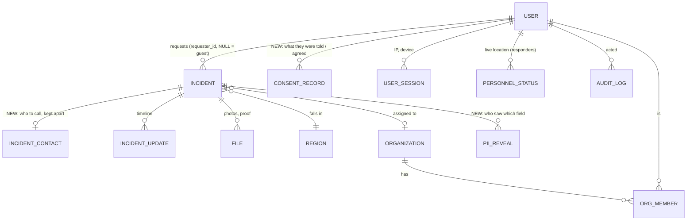
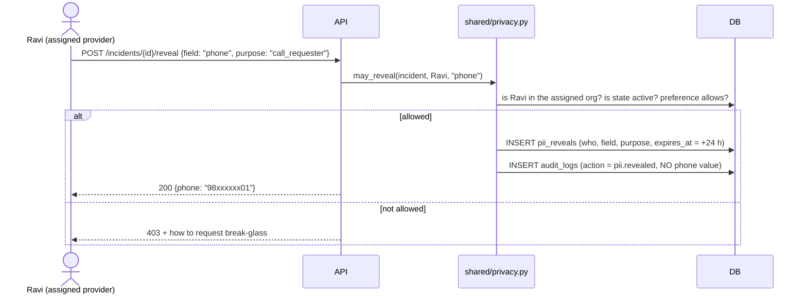

# IDRM — Privacy-first data design

> **Status:** ACCEPTED design (2026-11-24) — the owner adopted every default
> in §16, recorded in [ADR-0015](../adr/0015-privacy-first-reveal-ladder.md).
> **Not yet built:** the code in `idrm-mvp` still behaves as described in §12
> "Today". Build steps are Part G of `docs/review/PENDING-TASKS.md`.
>
> **Part of:** [DATA-DESIGN.md](DATA-DESIGN.md), the master data design
> (security, engineering, warehousing, quality, SDLC). This part owns the
> privacy detail.
>
> **Who it is for:** anyone, starting from zero. Read §0–§3 for the idea,
> §5–§7 for *what* is protected and *from whom*, §8–§9 for *how*, §13 for the
> full-fledged product.
>
> **Sources:** PRD and specs in `~/Downloads/idrm-artifacts/docs/mvp/` and
> `docs/ffp/` (10 PRD, 11 scope, 22 security & IAM, 50 data model); the real
> models in `shared/models/`; the incident router. Folder map and gaps:
> [IDRM-WORKSPACE-MAP.md](../review/IDRM-WORKSPACE-MAP.md).

---

## Contents

0. [The idea in one minute](#0-the-idea-in-one-minute)
1. [Why this matters: one flood, four people](#1-why-this-matters-one-flood-four-people)
2. [Words you need](#2-words-you-need)
3. [Seven principles](#3-seven-principles)
4. [Who uses the data, and what for](#4-who-uses-the-data-and-what-for)
5. [The data we hold](#5-the-data-we-hold)
6. [Sensitivity tiers](#6-sensitivity-tiers)
7. [The reveal ladder — who sees what, and when](#7-the-reveal-ladder--who-sees-what-and-when)
8. [Mechanisms — how each promise is kept](#8-mechanisms--how-each-promise-is-kept)
9. [Schema changes](#9-schema-changes)
10. [Walk-throughs](#10-walk-throughs)
11. [Threats and how the design answers them](#11-threats-and-how-the-design-answers-them)
12. [From today to target: the migration plan](#12-from-today-to-target-the-migration-plan)
13. [The full-fledged product (FFP)](#13-the-full-fledged-product-ffp)
14. [Law and standards](#14-law-and-standards)
15. [Rationale and trade-offs](#15-rationale-and-trade-offs)
16. [Decisions the owner must make](#16-decisions-the-owner-must-make)
17. [Check your understanding](#17-check-your-understanding)

---

## 0. The idea in one minute

IDRM connects people who need help in a disaster with people who can give it.
To do that it must hold **very personal data**: where someone is, that their
house is flooded, that their mother needs insulin, their phone number.

The design rests on one sentence:

> **Hide by default. Reveal by need. Never let hiding block a rescue.**

In practice:

- A responder browsing open requests sees **what** is needed and **roughly
  where** (about 1 km), never **who** or **exactly where**.
- The moment a responder's organization is **assigned**, they see the exact
  spot and description, and can **reveal the phone number with one tap**.
  That tap is recorded.
- When the job is done, the details **close again**, and after a set time
  they are **deleted or blurred**, leaving only statistics.
- The public sees only **counts**, never individual pins.

Everything below is the detail of how, why, and what it costs.

---

## 1. Why this matters: one flood, four people

Picture a flood in Chennai. Four people touch the same request.

| Person | What they do | What goes wrong without privacy design |
|---|---|---|
| **Meera**, 68, alone, ground floor | Reports: "Water at knee height, I take insulin, phone 98xxxxxx01" | Her exact address, age, "alone" and phone are visible to every registered provider in the city |
| **Ravi**, volunteer boat crew | Is assigned to Meera | He *needs* her exact location and phone, now — hiding them would delay the rescue |
| **A fake "provider"** who registered to look around | Browses open requests | Learns which elderly people are alone, and which houses are empty after evacuation → scam calls, burglary |
| **Asha**, district coordinator | Approves requests, assigns boats | Needs the full picture of her district, not other districts' personal details |

The skeptic's point: **both failures are real.** Show too much and you help the
fake provider. Show too little and Ravi cannot find Meera. A good design is not
"maximum privacy"; it is **the right detail, to the right person, at the right
moment, and no longer.**

---

## 2. Words you need

| Word | Plain meaning | IDRM example |
|---|---|---|
| **Personal data** | Anything that identifies a person, alone or combined | Name, phone, exact location of a home, a photo of a face |
| **PII** | "Personally identifiable information" — same idea, US term | — |
| **Sensitive data** | Personal data that can cause serious harm if leaked | Health ("insulin"), "lives alone", a child's details, live location |
| **Identified** | You can see who it is | "Meera Iyer, 98xxxxxx01" |
| **Pseudonymous** | Real person behind it, but shown with a code; the key is held elsewhere | "Request K7Q-2" |
| **Anonymous** | No way back to the person, even for us | "14 food requests in Velachery today" |
| **Aggregate** | A count or sum over many people | Heat map of open requests per 1 km cell |
| **k-anonymity** | Only show a group count if at least *k* people are in it | Hide a cell that has 1 request in it; show a cell with ≥ 5 |
| **Need-to-know** | You see a detail only if your current task needs it | Ravi sees Meera's phone only once assigned to her |
| **Reveal** | A deliberate, recorded act of un-hiding one field | "Show phone" tap → audit row `pii.revealed` |
| **Break-glass** | Emergency override of the normal rule, with a reason, reviewed afterwards | Coordinator reveals a phone for a request outside her district |
| **Coarsening** | Making data less precise on purpose | Exact point → nearest 0.01° grid point (~1 km) |
| **Retention** | How long we keep something before deleting or blurring it | Guest phone deleted 30 days after the request closes |
| **Crypto-shredding** | Deleting the encryption key so encrypted copies (even in backups) become unreadable | FFP: per-person key deleted on erasure |
| **Data principal / fiduciary** | DPDP Act terms: the person the data is about / the organization deciding why and how it is processed | Meera / the IDRM operator |

---

## 3. Seven principles

1. **Collect less.** Every field must answer "which decision needs this?" If
   none, do not ask for it. *(Never ask for caste, religion, Aadhaar, income.)*
2. **Hide by default.** A new viewer, endpoint or report starts with nothing
   personal and earns each field.
3. **Reveal by need, at the right moment.** Visibility follows the incident's
   state and the viewer's relation to it, not only their role.
4. **Never block a rescue.** Every hidden field has a fast, recorded way to
   reveal it when life is at risk (one tap, or break-glass).
5. **Record the fact, not the data.** The audit log says *who saw which field
   of which request, and why* — it never copies the phone number itself.
6. **Everything expires.** Each kind of personal data has a retention clock.
   When it runs out, the data is deleted or coarsened, automatically.
7. **Keep personal data apart.** Identifying details live in their own small
   tables, reachable through one code path, so they are easy to guard, audit,
   encrypt and erase.

---

## 4. Who uses the data, and what for

The four roles are fixed (`citizen`, `provider`, `coordinator`, `admin`;
CLAUDE.md rule 3). Purpose drives what each may see.

| Role | Job in the PRD | Personal data they genuinely need | They do **not** need |
|---|---|---|---|
| **Citizen** (incl. a **guest** with no account) | Ask for help, track it, confirm it was done | Their own requests, in full; the name of the organization helping them | Anyone else's data |
| **Provider** (NGO, hospital, volunteer group member) | Find approved work, accept it, do it | Before assignment: type, urgency, rough area. After: exact place, description, a way to call | Requester identity across requests; requests not yet approved; other orgs' jobs |
| **Coordinator** | Triage, approve/reject, assign, oversee a region | Description and exact location of requests in their region; contact on demand | Bulk export of phone numbers; other regions' details (except break-glass) |
| **Admin** | Run the system: users, orgs, policies, health | Account data needed to manage users | Case details by default — admins run the platform, not rescues |
| *Public / media / government analysts* | Situational awareness, planning (PRD objective O3) | Aggregates only | Any individual request |

---

## 5. The data we hold

`idrm-mvp` has about 60 tables (see `docs/03-data-model.md`). Most hold no
personal data. The diagram shows only the entities that matter for privacy;
the three tables marked **NEW** are proposed in §9.



### 5.1 Where the personal data is (current schema)

| Group | Tables | Personal / sensitive fields | Notes |
|---|---|---|---|
| **Identity** | `users` | `email`, `name`, `phone`, `last_login_at`, `preferences` | Needed for accounts |
| | `user_sessions`, `login_attempts` | `ip_address`, `user_agent`, `device_fingerprint`; `login_attempts.email` even for **non-users** | Security purpose; must expire |
| | `password_*`, `email_verification_tokens` | hashes, one-time tokens | Secrets, never shown |
| **Incidents** | `incidents` | `location` (exact point), `description` (free text — people type phone numbers, health details, names here), `guest_contact` (phone), `tracking_token`, `requester_id`, `review` | **The heart of the risk** |
| | `incident_updates` | `note` (free text) | Same free-text risk |
| **Files** | `files` + MinIO | photos (faces, house numbers, **EXIF GPS**) | |
| **Comms** | `messages`, `chat_messages`, `notifications`, `notification_deliveries` | message bodies; phone/email via delivery | |
| **Operations** | `personnel_statuses`, `unit_statuses` (+ `_events`) | **live latitude/longitude of responders** | Responders have privacy too |
| | `shift_signups`, `personnel_certifications`, `training_*` | attendance, qualifications | Employment-like data |
| **Governance** | `entity_lists`, `entity_list_matches`, `rate_limit_events` | raw email / phone / IP / device values | Used for blocking abuse |
| **Audit** | `audit_logs` | `ip_address`, `old_values`/`new_values` (could copy any field) | Immutable → must stay free of personal values |
| No personal data | regions, policies, resources, inventory, alerts, ICS lanes, calendars | — | Organizational, not personal |

---

## 6. Sensitivity tiers

Every field gets one tier. The tier decides default visibility, logging,
retention and (in the FFP) encryption.

| Tier | Name | Meaning | Examples | Default rule |
|---|---|---|---|---|
| **T0** | Public | Safe for anyone | region names, alert text, org names, aggregate counts (k ≥ 5) | Anyone |
| **T1** | Operational | About the *need*, not the *person* | service type, priority, status, age of request, **coarse** location, scrubbed summary | Any authorised staff or provider allowed to see the request |
| **T2** | Personal | Identifies a person | name, phone, email, **exact** location, free-text description, photos, requester id | Owner + assignee + coordinator of the region; reveal is recorded |
| **T3** | Sensitive | Serious harm if leaked | health needs, "alone / elderly / disabled / child", responder live location, (FFP) biometrics | Assignee only, only while active; never in exports |
| **S** | Secret | Proves identity or grants access | password hashes, refresh-token hashes, `tracking_token`, reset tokens | **No one**, ever, after creation |

> **Why tiers and not just roles?** Because the same person needs different
> detail at different times. Ravi (provider) should see T1 while browsing and
> T2/T3 once assigned. Roles alone cannot express "once assigned".

---

## 7. The reveal ladder — who sees what, and when

This is the core of the design. Read across a row to see how much of one
request a viewer sees.

**Legend:** ✅ shown · 🟦 shown coarsened/scrubbed · 🔓 hidden, one tap reveals (recorded) · 🚨 break-glass only (reason + review) · ❌ never

| Viewer → / Field ↓ | Public | Owner (citizen or guest with token) | Provider, request **not approved** | Provider, approved, **not assigned** | Provider, **own org assigned** (accepted / in progress) | Coordinator, **own region** | Coordinator, other region | Admin |
|---|---|---|---|---|---|---|---|---|
| Type, priority, status, age | aggregate only | ✅ | ❌ | ✅ | ✅ | ✅ | ✅ | ✅ |
| Location | aggregate (cell, k≥5) | ✅ | ❌ | 🟦 ~1 km | ✅ exact | ✅ exact | 🟦 | 🟦 |
| Description | ❌ | ✅ | ❌ | 🟦 scrubbed summary | ✅ | ✅ | 🟦 | 🚨 |
| Photos | ❌ | ✅ | ❌ | ❌ | ✅ | ✅ | 🚨 | 🚨 |
| Requester first name | ❌ | ✅ | ❌ | ❌ | ✅ | ✅ | 🚨 | 🚨 |
| Phone | ❌ | ✅ | ❌ | ❌ | 🔓 | 🔓 | 🚨 | 🚨 |
| Health / vulnerability flags (T3) | ❌ | ✅ | ❌ | 🟦 "vulnerable person: yes" | ✅ | ✅ | ❌ | ❌ |
| Requester id | ❌ | — | ❌ | ❌ (per-request code instead) | ❌ | ✅ | ❌ | ✅ (account admin) |
| `tracking_token` | ❌ | shown **once**, at creation | ❌ | ❌ | ❌ | ❌ | ❌ | ❌ |

**After the request ends** (`completed`, `verified`, `cancelled`, `rejected`):
the assignee keeps their view for a **grace window (proposed 72 h)** for
follow-up, then drops back to the "not assigned" column. The retention clock
(§8.11) starts.

The same ladder as a picture — what an assigned provider can see as the
request moves:

```mermaid
stateDiagram-v2
    direction LR
    created: created<br/>providers see NOTHING
    approved: approved<br/>providers see type, urgency, ~1 km
    accepted: accepted / in_progress<br/>assigned org sees exact spot,<br/>description, photos; phone by tap
    closed: completed / verified / cancelled<br/>72 h grace, then back to ~1 km
    purged: after retention<br/>contact deleted, location coarsened,<br/>stats kept
    created --> approved: coordinator or auto-policy
    approved --> accepted: provider accepts / coordinator assigns
    accepted --> closed
    closed --> purged: retention job
    created --> closed: reject / cancel
```



### 7.1 Why these particular choices

- **Providers see nothing before approval.** ADR-0014 already says a provider
  may only *claim* an approved request. Showing unapproved requests gives
  nothing useful and exposes unvetted (possibly fake or abusive) reports.
- **Coarse location while browsing.** A provider deciding "is this near my
  boat?" needs the neighbourhood, not the door. ~1 km answers the question.
- **Phone behind a tap even for the assignee.** Not a barrier — one tap — but
  it makes every disclosure a recorded, deliberate act, which deters bulk
  harvesting and lets us answer "who called Meera?" later.
- **Coordinators see their own region fully.** Triage needs the full
  description and exact location. Other regions only through break-glass,
  because a coordinator in Pune rarely needs a Chennai phone number.
- **Admins do not see case details by default.** They run the platform. In a
  real emergency they use break-glass like anyone else.

### 7.2 Citizen choices

At submission the citizen (or guest) sees a short notice (§8.15) and two
choices, both pre-set to the safe-and-helpful default:

| Choice | Options | Default |
|---|---|---|
| How may the responder contact me? | "Show my number to the assigned team" · "Contact me only through the app" | Show to assigned team (one-tap reveal) |
| I am reporting for someone else | yes / no — if yes, their name and phone go in the same protected contact record | no |

---

## 8. Mechanisms — how each promise is kept

### 8.1 Keep personal data apart (the "contact vault")

Move the identifying fields of a request out of `incidents` into a one-to-one
table `incident_contacts`. The `incidents` row then holds only T1 data plus
the exact point.

```
incidents (T1 + exact point)          incident_contacts (T2/T3)  — NEW
┌──────────────────────────┐          ┌──────────────────────────────┐
│ id                       │ 1 ─── 1  │ incident_id (PK, FK)         │
│ service_type, priority   │          │ contact_name, contact_phone  │
│ status, region_id        │          │ on_behalf_of (bool)          │
│ location (exact)         │          │ vulnerability_flags[]  (T3)  │
│ location_coarse (~1 km)  │          │ contact_preference           │
│ public_summary           │          │ purge_after                  │
│ description (T2)         │          └──────────────────────────────┘
└──────────────────────────┘
```

**Why:** one small table is easy to guard (one function reads it), easy to
erase (one `DELETE`), easy to encrypt later (FFP), and an accidental
`SELECT * FROM incidents` in a report no longer leaks phone numbers.

### 8.2 One shaping function per audience

Today one function, `_to_response`, sends every field to every viewer. Replace
it with a single policy function in `shared/privacy.py` (shared by API and
console, CLAUDE.md rule 1):

```python
# shared/privacy.py  (sketch)
def shape_incident(incident, viewer) -> dict:
    tier = visibility(incident, viewer)          # reads the §7 ladder
    out = {"id": public_code(incident), "service_type": ..., "status": ...}
    if tier >= Tier.T1_COARSE:
        out["location"] = incident.location_coarse
        out["summary"] = incident.public_summary
    if tier >= Tier.T2_ASSIGNED:
        out["location"] = incident.location
        out["description"] = incident.description
        out["contact"] = {"first_name": ..., "phone": "hidden — tap to reveal"}
    return out                                    # never tracking_token
```

**Why one function:** the ladder is then written in exactly one place, is
unit-testable as a table ("viewer X, state Y → fields Z"), and a new endpoint
cannot forget it.

### 8.3 Coarse location: snap, don't jitter

```sql
-- stored once, recomputed when location changes
location_coarse = ST_SnapToGrid(location, 0.01)   -- ~1.1 km north-south
```

- **Snap, not random noise.** If each request added fresh random noise, a
  provider could ask 100 times and average the answers back to the true spot.
  Snapping always returns the same grid point, so there is nothing to average.
- **Sparse areas.** In a village, a 1 km cell may contain one house — the
  coarse point *is* the house. Option: a larger cell (0.05°, ~5 km) in regions
  marked rural, or the FFP's adaptive cells (§13). See decision D3.
- **Searching still works.** `/incidents/nearby` filters on the exact point
  inside the database but returns only the coarse one.

### 8.4 Free text: scrub before showing

People write phone numbers and names into descriptions. For viewers below T2,
show `public_summary`, produced at submission:

1. Remove anything that looks like a phone, email, Aadhaar-like 12-digit
   number, or URL (regular expressions).
2. Truncate to ~140 characters.
3. A coordinator may edit the summary during triage.

Being skeptical: regexes miss things. That is why the summary is shown only
to providers who are already vetted, and why the full text stays behind
assignment.

**Progress (2026-11-25, written, not run):** steps 1 and 2 exist as
`scrub_text` / `public_summary` in `shared/privacy.py`, applied on the fly to
every incident response as `summary` (length: `PRIVACY_SUMMARY_MAX_CHARS`).
Numbers spelled out in English words are caught; names, addresses and numbers
in Indian-language words are not (see DATA-CONFIGURATION.md §3.1). Step 3
needs the stored column from G-4.

### 8.5 Reveal on request



- **Rate-limited** (e.g. 20 reveals per hour per user) so a compromised
  account cannot bulk-harvest.
- **Time-boxed:** the reveal grants that field for 24 h; after that, tap again.
- **Commit before raising** is not needed here; a refused reveal writes no row.

### 8.6 Break-glass

For the 🚨 cells. The viewer picks a reason (`life_safety`, `cross_region_support`,
`data_subject_request`, `legal`) and types one line. The field is shown,
`pii_reveals.break_glass = true` is stored, and every break-glass event appears
on a **review list** in the console for another coordinator or admin to
confirm within 72 h. *Fast first, accountable after* — principle 4.

### 8.7 Guests and anonymity

A guest (no account) gets a `tracking_token` to follow their request.

- Return it **once**, in the `201 Created` response, never again (fixes G2).
- Store only `sha256(token)` in the database, so a database leak does not let
  anyone follow guests' requests. Lookup hashes the incoming token.
- The guest's phone goes into `incident_contacts`, not `incidents`.
- A guest can be **fully anonymous** to everyone but staff: no name required,
  phone optional (then the only contact is through the tracking page).

### 8.8 Files and photos

| Control | Rule |
|---|---|
| Strip metadata | Re-encode every image server-side and drop EXIF (GPS, device, time). Port `files/imaging.py` from `idrm-artifacts/code` |
| Private bucket | Already private; keep it so |
| Short links | Presigned URL lifetime 5 minutes (today 1 hour) |
| Who may fetch | Same ladder as "Photos" in §7, not "uploader or staff" |
| FFP | Automatic face and number-plate blurring for any shared or public use |

### 8.9 Audit without personal data

The audit table is immutable (ADR-0003): a row can never be changed or
deleted. So **anything personal written there is there forever** — which
collides with erasure rights. Rule:

| Write this | Not this |
|---|---|
| `{"fields_changed": ["contact_phone"]}` | `{"contact_phone": "98xxxxxx01"}` |
| `action = "pii.revealed", new_values = {"field": "phone", "purpose": "call_requester"}` | the revealed value |
| `resource_id = incident id` | name of the requester |

`shared/audit.py` gets a deny-list of field names (`phone`, `email`, `name`,
`description`, `guest_contact`, `contact_*`, `location`, `token`) that it
replaces with `"[redacted]"` before writing — a safety net, not the main
defence.

### 8.10 Matching without storing raw identifiers

Blocklists need to ask "is this phone blocked?" without keeping a readable
list of phones. Store `HMAC-SHA256(secret_pepper, normalised_value)` in
`entity_lists.entity_value` and `login_attempts.email`; compare hashes.
The pepper lives in settings (`.env`), never in the repo (rule 10). Staff can
still add an entry (it is hashed on the way in) but cannot read the list back.

### 8.11 Retention: everything expires

A daily job (`scripts/retention.py`, scheduled like the other purges) applies
this table. Numbers are **proposals** — decision D4.

| Data | Clock starts | After | Action |
|---|---|---|---|
| `incident_contacts` (name, phone, flags) | request closes | 30 days | **delete** |
| Exact `location` | request closes | 30 days | replace with `location_coarse` |
| `description`, `incident_updates.note` | request closes | 90 days | replace with `public_summary` / null |
| Photos (`files` + MinIO object) | request closes | 30 days | delete |
| Chat and direct messages | sent | 90 days | delete |
| Notifications, delivery records | sent | 30 days | delete |
| Responder live location history | recorded | 7 days | delete (current status overwrites) |
| `user_sessions` | expiry | 90 days | delete (exists as manual SQL) |
| `login_attempts`, `rate_limit_events` | event | 90 days | delete |
| `pii_reveals` | reveal | 1 year | delete |
| Deactivated accounts | deactivation | 1 year | pseudonymise (name → "Former user", email/phone null) |
| `audit_logs` | write | ≥ 1 year (spec), 7 years target | keep; contains no personal values by §8.9 |
| Aggregates (counts per cell/day) | — | forever | keep — anonymous |

A `legal_hold` flag on an incident pauses every clock for it (court order,
death inquiry). **Backups:** keep at most 35 days so deleted data truly
disappears within about a month; the FFP adds crypto-shredding (§13).

### 8.12 Public and analytics views: counts only

Public dashboards and exported reports read a **database view** that already
groups by cell and day and drops groups smaller than 5:

```sql
CREATE VIEW public_incident_counts AS
SELECT region_id, location_coarse, service_type, date_trunc('day', created_at) AS day,
       count(*) AS n
FROM incidents WHERE deleted_at IS NULL
GROUP BY 1,2,3,4
HAVING count(*) >= 5;          -- k-anonymity threshold
```

Give the reporting code a database role that can read **only** this view.
Then a bug in a report cannot leak individual rows, because the rows are not
reachable.

### 8.13 Responders are people too

Live location of providers (`personnel_statuses`) is shown only to the
dispatchers and coordinators of their organization, only while the person's
status is on duty (`responding`, `on_scene`, …), and stops being recorded at
`off_duty`. Teammates see the unit, not each person's dot, unless a lane
assignment puts them together (ICS).

### 8.14 Logs, errors and backups

- Application logs carry ids, never names, phones, descriptions or tokens
  (add a log filter that masks those keys).
- Error reports (Sentry or similar) scrub request bodies.
- Backups are encrypted at rest and kept ≤ 35 days (see §8.11).

### 8.15 Notice and consent records

India's DPDP Act requires telling people **what** is collected and **why**
before or when collecting it, and being able to show what they were told.

- Show a 3-line notice at submission: *"We share your location and request
  with the response team assigned to you. Your phone number is shown only to
  that team. Details are deleted 30 days after your request closes."*
- Store `consent_records(notice_version, purpose, channel, granted, created_at,
  withdrawn_at)` for accounts and for guest requests.
- For life-safety requests the legal basis is likely DPDP's "legitimate uses"
  (§14), not consent — the notice is still shown. Legal confirmation: D6.

---

## 9. Schema changes

All as **one new Alembic revision** (rule 2), never by editing `sql/`.

```sql
-- NEW: identifying details of a request, kept apart (§8.1)
CREATE TABLE incident_contacts (
    incident_id          uuid PRIMARY KEY REFERENCES incidents(id) ON DELETE CASCADE,
    contact_name         varchar(100),
    contact_phone        varchar(20),
    on_behalf_of         boolean NOT NULL DEFAULT false,
    vulnerability_flags  text[] NOT NULL DEFAULT '{}',   -- coded: elderly, child, disabled, medical, pregnant
    contact_preference   varchar(20) NOT NULL DEFAULT 'reveal_to_assignee', -- or 'in_app_only'
    purge_after          timestamptz
);

-- NEW: every reveal of a hidden field (§8.5, §8.6)
CREATE TABLE pii_reveals (
    id            uuid PRIMARY KEY DEFAULT gen_random_uuid(),
    incident_id   uuid NOT NULL REFERENCES incidents(id),
    viewer_id     uuid NOT NULL REFERENCES users(id),
    field         varchar(40) NOT NULL,
    purpose       varchar(40) NOT NULL,
    break_glass   boolean NOT NULL DEFAULT false,
    reason_text   varchar(200),
    reviewed_by   uuid REFERENCES users(id),
    reviewed_at   timestamptz,
    expires_at    timestamptz NOT NULL,
    created_at    timestamptz NOT NULL DEFAULT now()
);

-- NEW: what each person was told and agreed to (§8.15)
CREATE TABLE consent_records (
    id              uuid PRIMARY KEY DEFAULT gen_random_uuid(),
    user_id         uuid REFERENCES users(id),
    incident_id     uuid REFERENCES incidents(id),        -- for guests
    notice_version  varchar(20) NOT NULL,
    purpose         varchar(40) NOT NULL,
    legal_basis     varchar(20) NOT NULL,                  -- 'consent' | 'legitimate_use'
    channel         varchar(20) NOT NULL,                  -- web, sms, ivr, staff_entry
    granted         boolean NOT NULL,
    created_at      timestamptz NOT NULL DEFAULT now(),
    withdrawn_at    timestamptz
);

-- CHANGED: incidents
ALTER TABLE incidents
    ADD COLUMN location_coarse     geometry(Point, 4326),
    ADD COLUMN public_summary      varchar(160),
    ADD COLUMN tracking_token_hash char(64) UNIQUE,     -- replaces tracking_token
    ADD COLUMN closed_at           timestamptz,
    ADD COLUMN legal_hold          boolean NOT NULL DEFAULT false,
    ADD COLUMN pseudonymised_at    timestamptz;
-- data step: copy guest_contact → incident_contacts, hash tracking_token,
-- then drop guest_contact and tracking_token.
```

Each new table and each state change writes an audit row (rule 6).

---

## 10. Walk-throughs

**A. Meera, guest, reports by phone-web.** She submits; sees the notice;
gets a tracking link once. `incidents` stores the point and a scrubbed
summary; `incident_contacts` stores her phone and flags `elderly, medical`.
No provider sees anything yet.

**B. Asha, coordinator, approves.** She sees the full description and exact
spot (her region). She approves. Audit: `incident.approved`.

**C. Ravi browses.** He sees "Rescue · critical · ~1 km from Velachery
station · vulnerable person: yes · 12 min ago". No name, no phone, no exact
point. He accepts.

**D. Ravi is assigned.** The exact point, description and "Meera" appear.
He taps *Show phone* → `pii_reveals` row + `pii.revealed` audit row; number
shown. He calls, finds her, completes.

**E. After.** Meera confirms (`verified`). 72 h later Ravi's view closes.
30 days later the retention job deletes her phone and flags, and replaces the
exact point with the grid point. The statistics ("1 critical rescue, this
cell, this day") remain forever.

**F. Meera asks "what do you hold about me?"** (an account holder). Staff
use the *data request* screen: export her account, requests and the list of
who revealed what (`pii_reveals`). If she asks for erasure: contacts deleted,
account pseudonymised, audit rows kept (they hold no personal values), and she
is told so.

**G. Break-glass.** A coordinator in the neighbouring district must call
Meera because her boats are closer. She clicks *Emergency access*, picks
`cross_region_support`, writes one line. The phone shows; tomorrow Asha sees
it on the review list and confirms.

---

## 11. Threats and how the design answers them

| Threat | Example | Answer |
|---|---|---|
| **Fake responder** | Registers as a provider to find people alone | Org verification; nothing visible before approval; only coarse data before assignment; reveals recorded and rate-limited |
| **Looters / burglars** | Look for evacuated (empty) homes | No exact points before assignment; public sees only k≥5 aggregates |
| **Scammers** | Call victims pretending to be rescuers | Phones only to the assigned team, one tap at a time; notice tells citizens which org is coming |
| **Stalker / abusive partner** | Uses a "help request" to find someone | Owner-only view of their own requests; requester id never shown to providers; break-glass reviewed |
| **Curious insider** | Staff browsing neighbours' requests | Region scoping; reveals and break-glass logged and reviewed |
| **Triangulation** | Re-query coarse points to recover the exact one | Deterministic snapping (§8.3) |
| **Token leak** | `tracking_token` copied from a provider's screen | Shown once; stored hashed |
| **Database or backup leak** | Disk stolen | Contacts deleted on schedule; hashed identifiers; encrypted backups; FFP field encryption |
| **Photo leak** | GPS in EXIF reveals home | EXIF stripped; 5-minute links |
| **Too much privacy** | Ravi cannot reach Meera | One-tap reveal for assignees; break-glass; first name shown on assignment |

---

## 12. From today to target: the migration plan

**Progress:** steps 1 and 2 (with the verified-organization check, gap WF3)
have code written on 2026-11-24 — not yet run against a database. See
PENDING-TASKS Part G.

**Before that change (verified by reading the code on 2026-11-24, not by running it):**
every provider sees every request, including unapproved ones, with exact
coordinates, `requester_id` and the guest's `tracking_token`; the assigned
provider has no way to obtain a phone number; photos keep EXIF; nothing
expires automatically. Full list: gaps G1–G11 in
[IDRM-WORKSPACE-MAP.md §3.1](../review/IDRM-WORKSPACE-MAP.md#31-privacy-gaps--spec-says-one-thing-idrm-mvp-code-does-another).

Order of work — smallest, highest-value first. Steps 1–3 need no schema
change.

| Step | Change | Fixes | Size |
|---|---|---|---|
| 1 | Stop returning `tracking_token` except in the create response | G2 | tiny |
| 2 | `_may_view` / list / nearby: providers see only `approved` requests, and for those not assigned to their org, coarse location (computed on the fly with `ST_SnapToGrid`), no `requester_id`, no description | G1, G3, G4 | small |
| 3 | Strip EXIF on upload (port from `idrm-artifacts/code/app/modules/files/imaging.py`); presigned links 5 min | G6 | small |
| 4 | Alembic revision: `incident_contacts`, `pii_reveals`, `consent_records`, new `incidents` columns; data step moves `guest_contact` and hashes tokens | G5, G10 | medium |
| 5 | `shared/privacy.py`: `shape_incident`, `may_reveal`, scrubber; `POST /incidents/{id}/reveal`; console uses the same function | G1–G5 | medium |
| 6 | Audit deny-list in `shared/audit.py` | G7 | small |
| 7 | Retention job + schedule; `legal_hold` | G8, G11 | medium |
| 8 | HMAC hashing for `entity_lists` and `login_attempts` | G9 | small |
| 9 | Public counts view + reporting DB role | — | small |

Each step needs tests that read like the §7 table ("provider, not assigned,
approved → no phone, coarse location"), marked `pg` where they write rows, and
none may accept a 500 (rule 9). None of this has been run yet.

---

## 13. The full-fledged product (FFP)

The MVP design above is deliberately simple. The FFP keeps every rule and
strengthens the mechanisms.

| Area | MVP (this document) | FFP |
|---|---|---|
| **Privacy levels per request** | Fixed ladder (§7) | Citizen picks **Public / Protected / Private** (already planned in `ffp/50-data-model.md`). *Public* = summary may appear on a public map (useful for community help); *Protected* = the §7 ladder; *Private* = coordinators only, providers only after assignment and only what the coordinator releases |
| **Contact** | Real number revealed | **Number masking**: the responder calls a relay number that forwards to the citizen for the life of the job (as ride-hailing apps do); the real number is never shown |
| **Encryption at rest** | Disk-level + separation | **Field-level AES-256-GCM** for T2/T3 with **envelope encryption**: a key per person, wrapped by a master key in a **KMS/Vault**. Erasure = delete the person's key (**crypto-shredding**) → even backups become unreadable |
| **Services** | One database | Each service owns its data (`users-service`, `incidents-service`, …, see `idrm-monorepo/services/`). A dedicated **privacy/consent service** owns contacts, reveals and consent; others hold only pseudonymous ids and must ask it to reveal |
| **Events** | — | Events on the bus carry ids and T1 data only; consumers that need contact call the privacy service |
| **Rights portal** | Staff-run data requests | Self-service: see my data, download, correct, delete, withdraw consent, nominate someone (DPDP right), grievance tracking with deadlines |
| **Location** | Fixed grid | **Adaptive cells** (e.g. H3 hexagons, bigger where population is sparse) so every cell holds enough people |
| **Analytics** | k ≥ 5 counts | **Differential privacy** (calibrated noise on published statistics) for open data and research releases |
| **Biometrics** | Face *detection* only, nothing stored | Missing-person **face matching** only with explicit, purpose-limited consent, separate store, strict retention (`ffp/22-…` §6) |
| **Mobile / offline** | — | Encrypted local storage; offline caches hold T1 only; remote wipe |
| **Intake channels** | Web | SMS / IVR / WhatsApp: same ladder, notice read aloud or sent by SMS, consent recorded with channel |
| **Governance** | This document | Data Protection Officer, **DPIA** (privacy impact assessment) per release, data inventory kept in a catalogue, annual audit, breach drills |
| **Data residency** | Single server | Hosting in India; cross-border transfer only as the law permits |
| **Partners** | — | Data-sharing agreements with NGOs/government that bind them to the same ladder and retention |

---

## 14. Law and standards

*Not legal advice. Confirm with counsel before launch (decision D6).*

| Source | What it asks | Where this design answers |
|---|---|---|
| **India — Digital Personal Data Protection Act, 2023** | Notice; consent **or** a listed "legitimate use" (the Act's Section 7 lists uses including responding to medical emergencies and providing assistance during a disaster); purpose limitation; erase when the purpose is served; security safeguards; breach notification to the Data Protection Board and affected people; rights to access, correct, erase, grievance, nominate; verifiable parental consent for children (under 18) | §8.15 notice & consent records; §8.11 retention; §10 F rights; §8.9 audit; §16 D6 |
| **DPDP Rules (2025)** | Operational detail and phased start dates | Check current dates with counsel |
| **ICRC Handbook on Data Protection in Humanitarian Action** | "Do no harm" with data; vital interest as a basis in emergencies; minimisation; care with vulnerable groups | §1, §3, §7 |
| **IASC Operational Guidance on Data Responsibility in Humanitarian Action** | Data sensitivity classification; responsible sharing between agencies | §6 tiers; FFP partners |
| **ISO/IEC 27701, NIST Privacy Framework** | Management system and controls for privacy | FFP governance |

The MVP spec already names DPDP (`mvp/22-…` §8) and defers field-level
encryption and privacy levels to the FFP; this document is consistent with
that.

---

## 15. Rationale and trade-offs

| Question | Answer |
|---|---|
| *Why not just encrypt everything now?* | Encryption protects stolen disks; it does nothing when the app itself shows data to the wrong user — which is today's real gap (G1–G4). Fix who-sees-what first; add field encryption in the FFP when keys can be managed properly. Badly managed keys lose data or give false comfort. |
| *Why a separate contact table instead of PostgreSQL row-level security?* | Simpler to read, test and erase, and works the same in API and console. Row-level security can be layered on later. |
| *Won't the reveal tap slow rescues?* | It is one tap, for the assignee only, with no approval step. The delay is seconds; the benefit is a record of every disclosure and a brake on bulk harvesting. |
| *Why hide anything from coordinators?* | Only other regions and bulk exports. Inside their region they see everything. |
| *Why let data expire when history is valuable?* | The **statistics** stay forever. What is deleted is the ability to identify a person — which is no longer needed once they are safe, and is what causes harm if leaked. |
| *Isn't 1 km too vague for a provider?* | It answers "is this near me?". Exact location arrives the moment they are assigned. |
| *What can go wrong with this design?* | Scrubbing misses some phone numbers; coarse cells in villages identify homes; a compromised assignee account still sees its own jobs; audit IPs are personal data kept for a year. Each is mitigated (vetting, bigger rural cells, rate limits, documented security purpose), not eliminated. |

---

## 16. Decisions the owner must make

**Decided 2026-11-24:** the owner chose "Adopt defaults" — option **(a)** for
every row below. The record is [ADR-0015](../adr/0015-privacy-first-reveal-ladder.md);
the other options are kept here so the reasoning stays visible. D6 still needs
legal counsel to confirm before launch.

| # | Question | Options (recommended first) |
|---|---|---|
| **D1** | Should providers see **unapproved** requests? | **(a) No** — consistent with ADR-0014, protects against fake reports · (b) Yes, coarse only — lets providers prepare earlier |
| **D2** | How does an **assigned** provider get the phone? | **(a) One-tap reveal, recorded** · (b) Shown automatically on assignment — slightly faster, no record of who looked · (c) In-app chat only — most private, fails when data is poor |
| **D3** | **Coarse location** size while browsing | **(a) 0.01° (~1 km) urban, 0.05° (~5 km) for regions marked rural** · (b) 0.01° everywhere — simpler, identifies rural homes · (c) 0.05° everywhere — safest, less useful in cities |
| **D4** | **Retention** of contact details after closure | **(a) 30 days** · (b) 7 days — less risk, less time for follow-up and complaints · (c) 90 days — more follow-up, more risk |
| **D5** | May **admins** see case details? | **(a) Only by break-glass** · (b) Yes, like coordinators — matches today's code |
| **D6** | Legal basis for life-safety requests | **(a) Treat as DPDP "legitimate use", still show the notice, confirm with counsel before launch** · (b) Ask for consent on every request — adds a step for people in danger |
| **D7** | Grace window for the assignee after closure | **(a) 72 hours** · (b) 24 hours · (c) none |

---

## 17. Check your understanding

1. A provider sees a request at "~1 km". What two things must happen before
   they see the exact spot? *(It must be approved, and their organization
   assigned.)*
2. Why does the design snap coordinates instead of adding random noise?
   *(Noise can be averaged away by repeated queries.)*
3. The audit log can never be edited. Why does that mean it must never
   contain a phone number? *(It could then never be erased, breaking erasure
   rights.)*
4. Meera asks to be deleted. What remains? *(Pseudonymous audit rows and
   anonymous counts.)*
5. Name one way this design could fail *open* (too much shown) and one way it
   could fail *closed* (rescue delayed). *(Open: a scrubber misses a number.
   Closed: an assignee's phone has no data for in-app-only contact.)*
